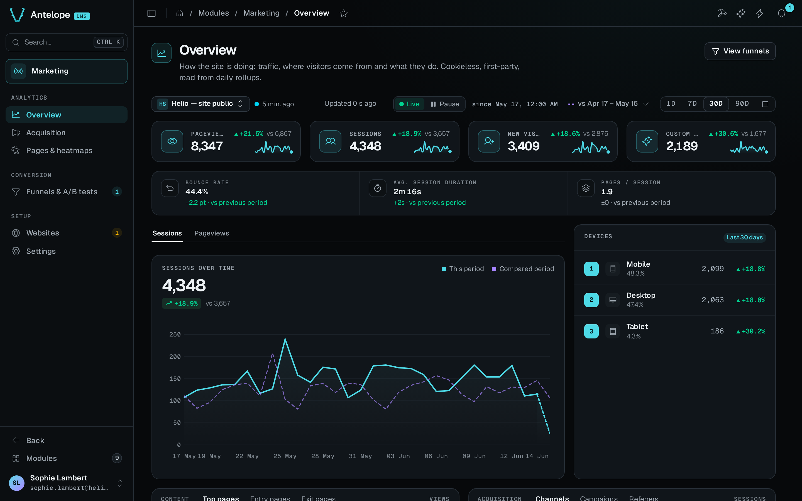

<a href="https://github.com/AntelopeJS/dms"></a>

<div align="center">

# `@antelopejs/dms-marketing`

<a href="https://www.npmjs.com/package/@antelopejs/dms-marketing"></a> <a href="./LICENSE"></a> <a href="https://discord.gg/g4pFt6eXqu"></a> <a href="https://dms.antelopejs.com/docs/modules/marketing"></a> <a href="https://github.com/AntelopeJS/dms"></a>

**Traffic, funnels with A/B splits and click heatmaps for your website, first-party and without cookies.**

[Try it in the live demo](https://dms-demo.antelopejs.com/modules/marketing) · [Documentation](https://dms.antelopejs.com/docs/modules/marketing) · [All modules](https://github.com/AntelopeJS/dms#modules)

</div>



## What it does

- Shows pageviews, sessions, new visitors and custom events against the previous period, with acquisition channels and UTM campaigns.
- Draws clicks and scroll depth over a snapshot of any tracked page, even on sites that refuse framing.
- Measures ordered conversion funnels with per-step drop-off, optionally split into server-assigned A/B variations.
- Stays first-party and cookieless. It calls no external service, stores no IP address or user agent, and keeps the data in the project's MongoDB.

## Install

Run the AntelopeJS CLI from the root of a project that already loads `@antelopejs/dms`:

```bash
ajs project modules add @antelopejs/dms-marketing
```

## Quick start

Restart the backend, then the frontend, and open **Modules › Marketing**. Click **Add a website** on the **Websites** page. The install guide that opens gives the tracker snippet in HTML, Nuxt or Google Tag Manager form. The HTML form looks like this:

```html
<script defer src="https://<backend>/api/marketing/tracker.js"
        data-website-id="<website id>"></script>
```

Behind a reverse proxy, set the DMS `auth.trustedProxies` option. See [Installation](https://dms.antelopejs.com/docs/modules/marketing/installation).

## Compatibility

The module also needs a DMS backend in a release that implements the `@antelopejs/interface-dms` range in the [module README compatibility block](packages/dms-marketing/README.md#compatibility), and the `@antelopejs/dms-frontend` renderer in the range its frontend module declares in `engines["@antelopejs/dms-frontend"]` of `packages/dms-marketing/frontend-vue/package.json`. The `ajs dms` CLI refuses to build it with a renderer outside that range.

## Packages

| Package | Directory | Role |
| --- | --- | --- |
| [`@antelopejs/dms-marketing`](https://www.npmjs.com/package/@antelopejs/dms-marketing) | [`packages/dms-marketing`](./packages/dms-marketing) | The module: tracker, collection, dashboards, funnels and heatmaps. |
| [`@antelopejs/interface-dms-marketing`](https://www.npmjs.com/package/@antelopejs/interface-dms-marketing) | [`packages/interface-dms-marketing`](./packages/interface-dms-marketing) | The interface other modules call to read aggregated analytics. |

## Documentation

- [Consumer reference](./packages/interface-dms-marketing/docs/1.index.md)
- [Introduction](https://dms.antelopejs.com/docs/modules/marketing/introduction)
- [Installation](https://dms.antelopejs.com/docs/modules/marketing/installation)
- [Configuration](https://dms.antelopejs.com/docs/modules/marketing/configuration)
- [Usage](https://dms.antelopejs.com/docs/modules/marketing/usage/overview)
- [Extending](https://dms.antelopejs.com/docs/modules/marketing/extending)
- [FAQ](https://dms.antelopejs.com/docs/modules/marketing/faq)
- [Architecture](https://dms.antelopejs.com/docs/modules/marketing/architecture)

The guide's sources live in [`packages/dms-marketing/docs`](./packages/dms-marketing/docs). [`KNOWN-ISSUES.md`](./packages/dms-marketing/KNOWN-ISSUES.md) lists the defects found end to end, how each was closed, and the two still open in the DMS core. The module ships the `dms-marketing` Claude Code skill in [`packages/dms-marketing/skills`](./packages/dms-marketing/skills), declared under `antelopeJs.skills`.

## Contributing

Read [CONTRIBUTING.md](./CONTRIBUTING.md) before opening a pull request. The playground expects MongoDB on `mongodb://localhost:27017` (`MONGO_URL` overrides it) and serves a tracked demo site at `http://localhost:5010/demo`.

Run these commands from the repository root. One install covers the shared tooling, the backend, the interface and the Vue frontend module. Each package keeps its own lockfile. The playground is a project of its own and needs a separate install.

```bash
pnpm install
pnpm build          # the interface, then the module
pnpm lint
pnpm typecheck
pnpm knip
pnpm test           # the frontend module's vitest suite
pnpm --dir packages/dms-marketing test:backend  # the backend suite, against a real DMS
pnpm run checks     # typecheck, lint, format, knip, tests, size, suppressions and sync
cd packages/dms-marketing/playground
pnpm install --ignore-workspace
pnpm dev            # backend on :5010
pnpm frontend:dev   # dashboard, in a second terminal
```

<details>
<summary>Repository notes</summary>

- The admin pages are declared backend-side as trees of DMS blocks. `frontend-vue/` is a Vue frontend module whose `dms.frontend.ts` declares the `DmsMarketing` component prefix, registers every component of `app/components/` under it, and ships its own i18n catalogs ([Architecture](https://dms.antelopejs.com/docs/modules/marketing/architecture/frontend#frontend-layout)).
- The module implements the interface, so it caps its range below the next minor (`>=<interface version> <0.<minor + 1>.0`). Release the interface first (`release-interface.yml`): its release commit runs `sync`, which moves the module's range to the new minor. Then release the module (`release.yml`), which refuses to run until the interface version in the tree resolves on npm.
- Declare `zod` as `^3.24.2`, the range `@antelopejs/dms` and `@antelopejs/interface-dms` declare, so a project installs one zod copy that the module and the DMS share.

</details>

## Part of AntelopeJS DMS

This module installs into [AntelopeJS DMS](https://github.com/AntelopeJS/dms), the open-source back office. Every module adds its pages to the same dashboard, behind the same sign-in and roles.

<!-- antelopejs-dms-modules:start -->

| Module                                                           | What it adds                                                                             |
| ---------------------------------------------------------------- | ---------------------------------------------------------------------------------------- |
| [`dms-builder`](https://github.com/AntelopeJS/dms-builder)       | Edit pages, tables and data sources by clicking, as TypeScript that compiles             |
| [`dms-ai`](https://github.com/AntelopeJS/dms-ai)                 | An assistant chat in the dashboard, on your own Claude Code or Codex                     |
| [`dms-database`](https://github.com/AntelopeJS/dms-database)     | Schemas, relation diagrams, a data browser and a query console                           |
| [`dms-api`](https://github.com/AntelopeJS/dms-api)               | API health, request logs, per-route statistics and a request tester                      |
| [`dms-automation`](https://github.com/AntelopeJS/dms-automation) | Node-graph automations on schedules, webhooks and DMS events, with a trace for every run |
| [`dms-mailing`](https://github.com/AntelopeJS/dms-mailing)       | E-mail templates in a block editor, versions, a send log and delivery metrics            |
| [`dms-lang`](https://github.com/AntelopeJS/dms-lang)             | Translation coverage, a translation matrix and a translation queue                       |
| [`dms-media`](https://github.com/AntelopeJS/dms-media)           | A media library with folders, per-folder permissions, image sizes and light editing      |
| [`dms-saas`](https://github.com/AntelopeJS/dms-saas)             | Self-service sign-up, plans that gate features, and Stripe billing                       |
| [`dms-marketing`](https://github.com/AntelopeJS/dms-marketing)   | Traffic, conversion funnels with A/B splits and click heatmaps, without cookies          |
| [`dms-frontend`](https://github.com/AntelopeJS/dms-frontend)     | The `ajs dms` CLI, the Vue renderer and the SDK every frontend module builds on          |

<!-- antelopejs-dms-modules:end -->

## License

[Apache-2.0](./LICENSE)
