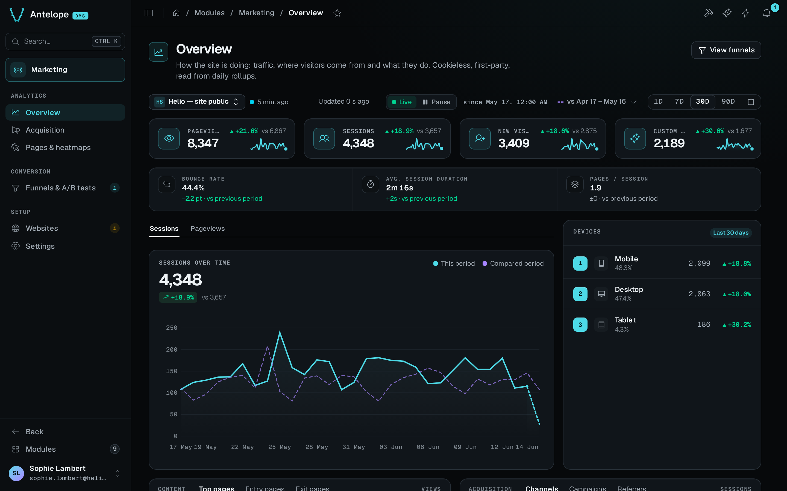
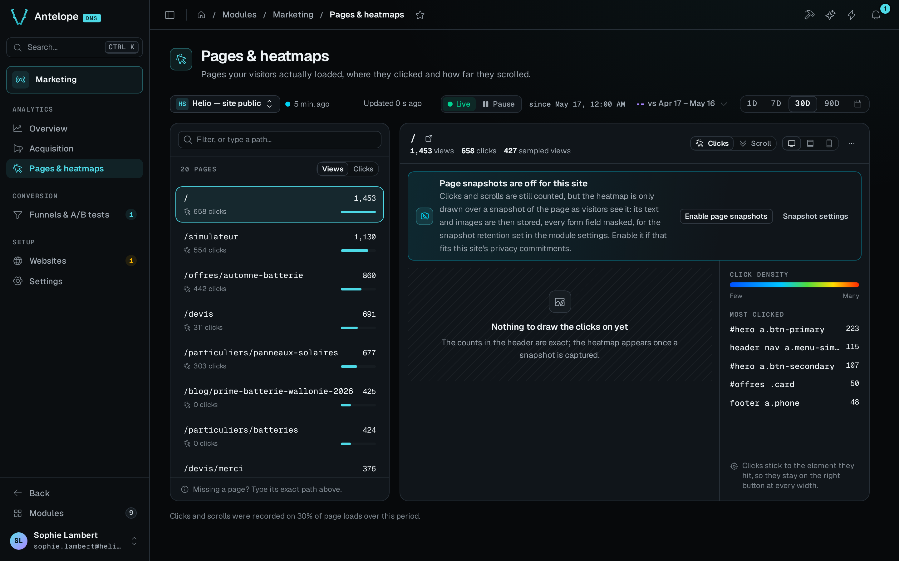

`@antelopejs/dms-marketing` adds marketing analytics to the AntelopeJS DMS: traffic dashboards, conversion funnels with optional A/B splits, and click heatmaps. It is first-party. It calls no external service, sets no cookie, and keeps the data in your project's MongoDB.

## One signup journey, measured end to end

A useful first question is one you can act on. How many sessions reach `/pricing` and then submit the signup form?

After you [install the module and the tracker](/docs/modules/marketing/installation), the website's install guide confirms that a first pageview arrived. The signup form then calls `window.dmsMarketing?.track("signup_submitted")` on the visitor site after a successful submission. A [funnel](/docs/modules/marketing/usage/funnels) with the page `/pricing` as its first step and the custom event `signup_submitted` as its second answers the question.

If 100 sessions enter and 12 complete both steps in order, the funnel reports 12% conversion. These numbers illustrate the calculation and do not come from the playground. The funnel measures a journey inside one session. It does not join one person's visits across days. An A/B split belongs on the funnel once this baseline works.

## What it brings

::card-group
  ::card{title="Traffic overview" icon="i-lucide-chart-line" to="/docs/modules/marketing/usage/overview"}
  Pageviews, sessions, new visitors and custom events with their change, session quality, devices and top lists.
  ::

  ::card{title="Acquisition" icon="i-lucide-megaphone" to="/docs/modules/marketing/usage/acquisition"}
  The split between direct, organic, social, email, referral and paid traffic, UTM campaigns and top referrers.
  ::

  ::card{title="Pages & heatmaps" icon="i-lucide-mouse-pointer-click" to="/docs/modules/marketing/usage/pages-and-heatmaps"}
  Clicks and scroll depth drawn over a snapshot of any tracked page.
  ::

  ::card{title="Funnels & A/B tests" icon="i-lucide-filter" to="/docs/modules/marketing/usage/funnels"}
  Ordered conversion journeys with per-step drop-off, optionally split into server-assigned variations scored with significance.
  ::
::

## The design choices behind it

**First-party and cookieless.** The backend identifies a visitor by an anonymous hash of the website, the IP address and the user agent, salted with a server secret and the current month. It never stores those raw inputs. Events store no IP address, no user agent and no headers. Page content lives in one place only, the heatmap snapshots that a website opts into, and a snapshot never holds a form value.

**Dashboards never scan raw events.** The module adds each event to a daily rollup as it writes the event, one bounded row per website and day. Raw events stay only for the raw-events retention, because heatmaps, funnels and A/B results read them.

**Heatmaps work on any site.** They are keyed on the pathnames the tracker reports, and each click is anchored to the element it hit. The backdrop is a snapshot captured in a visitor's browser, so a site that refuses framing still gets one.

**A/B tests need no experiment server.** A split is a facet of a funnel. The backend assigns variations from the visitor hash, the page asks for its variation with one call (`await dmsMarketing.variation("key")`), and the funnel's steps score the arms.

**Tenant isolation is structural.** Analytics tables live in per-tenant database instances, like the rest of the DMS.

[Architecture](/docs/modules/marketing/architecture) gives the reasoning behind each choice.

## Where it lives in the dashboard

The module appears in the sidebar as **Marketing**. Its pages sit under three headings, and every page lives at `/modules/marketing/<page>`:

| Heading | Pages |
| --- | --- |
| Analytics | [Overview](/docs/modules/marketing/usage/overview), [Acquisition](/docs/modules/marketing/usage/acquisition), [Pages & heatmaps](/docs/modules/marketing/usage/pages-and-heatmaps) |
| Conversion | [Funnels](/docs/modules/marketing/usage/funnels) and [A/B tests](/docs/modules/marketing/usage/ab-tests) on one page, with the funnel report and the funnel builder as hidden pages |
| Setup | [Websites](/docs/modules/marketing/usage/websites), with the install guide as a hidden page, and [Settings](/docs/modules/marketing/usage/settings) |

::note
Session cohorts and session replay are not built yet. [Architecture](/docs/modules/marketing/architecture#phasing) lists the phase plan and the current limits.
::
