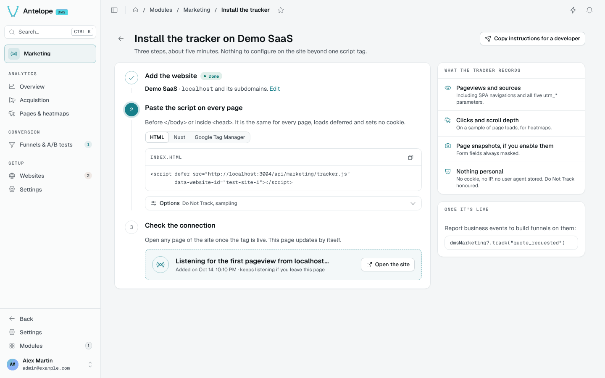

# Installation

Two sides to install: the **DMS project** that hosts the module (backend +
admin pages), and each **visitor-facing site** to be tracked (one `<script>`
tag). A third section covers running the module's own development playground.

::note
Both packages are published publicly on npm under the `@antelopejs` scope, like the DMS itself (`@antelopejs/dms`). No registry configuration or token is needed.
::

## 1. Install in the DMS project

### Requirements

- An AntelopeJS project running the DMS (`@antelopejs/dms` >=0.11.0 <1.0.0,
  with `@antelopejs/interface-dms` >=0.9.0 <1.0.0: its `useApiData` reads the module's
  pages on the server) on `@antelopejs/core`
  >=1.13.5, with its usual companions: `@antelopejs/mongodb` ^1.4.3 (the
  adapter used to verify conditional declaration writes and atomic import
  claims), `@antelopejs/api` >=1.3.4 (earlier
  releases answer a malformed JSON body with a 500), `@antelopejs/auth-jwt`.
- The DMS console built with `@antelopejs/dms-frontend` >=0.9.0 <0.10.0 —
  the range the frontend module declares in its `engines`.
- MongoDB — analytics data lives in the project's existing database
  deployment, in the DMS `dms-core` / `dms-tenant` schemas.

::warning
Marketing 0.6 runs on DMS 0.9 and renderer 0.6 only. On DMS 0.8, stay on
Marketing 0.4, or upgrade the project first: see
[Upgrading to DMS 0.9](/docs/building/upgrading-to-0-9).
See [DMS installation](/docs/getting-started/installation) for the toolchain and
[Troubleshooting](/docs/building/troubleshooting) for dependency and frontend errors.
::

### Declare the module

Add the module with the AntelopeJS CLI:

```bash [Terminal]
ajs project modules add @antelopejs/dms-marketing
```

The entry lands in the project's `antelope.config.ts`; every option is described in [Configuration](/docs/modules/marketing/configuration):

```typescript
export default defineConfig({
  modules: {
    "dms-marketing": {
      source: {
        type: "package",
        package: "@antelopejs/dms-marketing",
        version: "^0.6.0",
      },
      config: {
        // Optional: absolute path of a MaxMind country database (.mmdb).
        // Enables the visitor-country dimension: the collect IP is resolved
        // locally at ingestion and only the country code is stored. The
        // module ships no GeoIP data — supplying the file (GeoLite2 under
        // its EULA, or a commercial db) is the operator's licensing and
        // compliance decision. Replacing the file takes a restart.
        geoipDatabasePath: "/var/lib/geoip/GeoLite2-Country.mmdb",
      },
    },
    // … dms, mongodb, api, auth-jwt as in any DMS project
  },
});
```

### Behind a reverse proxy

The module identifies a visitor and rate-limits a source by the client
address the DMS resolves (`getClientIp`): `X-Forwarded-For` is only read
behind the reverse proxies the DMS trusts, its `auth.trustedProxies` option
(e.g. 1 behind one nginx, 2 behind a CDN and a load balancer). Left at its
default 0 behind a proxy, every visitor looks like the proxy; never set it
higher than the proxies actually there, as the entries past them are written
by the client.

**Upgrading from 0.3.** The module's own `trustedProxyHops` option is gone:
move its value to the DMS's `auth.trustedProxies`, which now covers both. An
IPv4-mapped address (`::ffff:198.51.100.7`, a backend listening on IPv6) is
now read as plain IPv4, so the visitors reaching it that way get a new
visitor hash once, as on the monthly salt rotation: they count as new
visitors and may draw another arm of a running A/B test.

### Allow the tracked sites' origins (CORS)

The built-in tracker does not need a CORS grant for the visitor site: it sends
beacons as `text/plain` without a preflight and loads assignments as a script.
Register the visitor site's host in the website's `domain` or `extraDomains`;
that is the ingestion check that rejects a foreign host.

Authenticated console requests still use the `@antelopejs/api` CORS settings.
When the console and API have different origins, allow the console's origin:

```typescript
api: {
  config: {
    cors: {
      allowedOrigins: ["https://dms.example.com"],
    },
  },
},
```

### Admin frontend

The admin pages are declared backend-side as trees of DMS blocks; the
components the module renders itself ship as a DMS frontend module inside
the package (`frontend-vue/`), a Vue 3 project whose root `dms.frontend.ts`
declares the `DmsMarketing` component prefix and registers them under it.
The module declares that frontend module through `AddFrontendModule`, and the DMS frontend loader
(`@antelopejs/dms-frontend`, CLI `ajs dms`) materializes it into the
generated Inertia workspace: `ajs dms prepare` against a running backend,
`ajs dms dev` to serve the console. Nothing has to be installed alongside
this package — the backend serves the module as an archive. Once up, the
module appears in the sidebar as **Marketing**, its pages under three
headings: **Analytics** (Overview, Acquisition, Pages & heatmaps),
**Conversion** (Funnels & A/B tests) and **Setup** (Websites, Settings). The
funnel report, the funnel builder and the install guide are hidden pages,
reached from the others. The headings do not appear in the URLs: every page
lives at `/modules/marketing/<page>`. The analytics pages render on the
server: the context bar reads the websites first, so the blocks arrive with
the page and its period, and a URL naming no website is redirected to the
saved one. The page preview's frames and the funnel builder still draw in the
browser.

## 2. Install on the visitor site

Register the site first, from the install guide or the Websites page ([Websites](/docs/modules/marketing/usage/websites)): its id is what the tag embeds.

One tag, before `</body>` or in `<head>`. The install guide gives it in
three forms — plain HTML, a Nuxt `app.head` entry and a Google Tag Manager
custom HTML tag — and **Copy instructions for a developer** copies it with
a short note for whoever edits the site:

```html
<script defer src="https://<dashboard>/api/marketing/tracker.js"
        data-website-id="<website id>"></script>
```

The snippet points at the dashboard's origin. Its frontend server
(`@antelopejs/dms-frontend` 0.6) forwards only the backend routes declared to
it, and refuses a state-changing request from another origin unless the route
is public: the module declares its three scripts (`tracker.js`,
`experiments.js`, `snapshot.js`) and its two beacons (`collect`, `snapshot`)
as `publicEndpoints`, which pass without a session. A tag pointing at the
backend's own origin works too.

Optional attributes:

| Attribute | Effect |
|---|---|
| `data-host-url` | override the collect origin (defaults to the script's own origin) |
| `data-heatmap-sample` | 0–1 click/scroll sampling rate for this site; overrides the module setting |
| `data-do-not-track="false"` | ignore the browser DNT signal |
| `data-exclude-paths` | comma-separated pages left uncounted: `/x`, `/x/*` (one segment below) or `/x/**` (the page and everything below) |

The tag stays live: page code that changes its `data-website-id` sends what
follows to that website, and removing the attribute pauses collection until
one is set again. To measure the DMS dashboard itself, no tag is needed: see
[Tracking the dashboard itself](/docs/modules/marketing/configuration#tracking-the-dashboard-itself).

Do **not** load it with `type="module"` — that defeats
`document.currentScript`, and the script cannot find its own attributes.

The tracker is cookieless, batches events, flushes with `sendBeacon`, and
tracks SPA navigations through `history.pushState`/`popstate`. What it
records and the JavaScript API it installs (`window.dmsMarketing.track(…)`)
are covered in [Tracker & custom events](/docs/modules/marketing/usage/tracking). On sites that enable
page snapshots, mark the elements that must never be captured with
`data-dms-marketing-mask` (text masked) or `data-dms-marketing-block`
(replaced by an empty box) — see
[Pages & heatmaps](/docs/modules/marketing/usage/pages-and-heatmaps#what-is-and-is-not-captured).

### Verify



The screenshot shows a local playground, not a verified production connection.
Use the snippet generated for your own website and public dashboard origin.

Step 3 of the install guide checks the connection by itself: it polls
`GET /api/marketing/websites/:id/connection` every 4 seconds and turns green
once a pageview stored since the site's creation arrives, with its date and
time, the host it came from (when this backend instance saw it), its path,
browser and device. **Check again** waits for a pageview sent after the
click (`?since=<epoch ms>`), to re-verify a site already live. A banner says
when collection is paused for the whole module or for the site. A beacon
refused because its host is not declared shows instead as *N events refused
from `<host>`*, with **Allow this host**, which adds the host to the
website's `extraDomains` (`POST /api/marketing/websites/:id/allow-host`).
Refusals are counted in memory, per backend instance, for an hour and for at
most 5 hosts per site: enough for a page that polls while someone installs
the tag, not an audit trail. The Websites page shows the same refused hosts
on the site's card, whatever its state.

By hand:

1. Load the site with the browser's network tab open: the tracker script must
   load from the backend, then `POST /api/marketing/collect` must answer
   **200** (a **403** means the page's host is not among the website's
   `domain`/`extraDomains`, a **404** that the website id is unknown or the
   site's **Collect data** switch is off). While collection is paused in
   [Settings](/docs/modules/marketing/usage/settings), the script is a no-op
   stub and the collect answer reports every event as `dropped`.
2. Within a minute, the page appears on `/modules/marketing/pages`, the
   overview counts the visit and the context bar reads *Live · last event …*
   for the site.

## 3. Development playground

The repository ships a full consumer project under
`packages/dms-marketing/playground/`: backend on
`:5010`, DMS console via `ajs dms dev`, and a demo site under
`http://localhost:5010/demo` — a small tracked multi-page site (pricing,
signup, SPA navigation, custom events, a prefilled form and masked elements)
that exercises every capture path with `data-heatmap-sample="1"` so nothing
is left to sampling. Its pages refuse framing (`X-Frame-Options: DENY`),
as production sites do, so the heatmap backdrop is exercised the way real
sites exercise it: through page snapshots, enabled on the seeded website.

```bash
pnpm install --filter @antelopejs/dms-marketing...   # workspace root
pnpm build                       # interface, then tsc → dist/
cd packages/dms-marketing/playground
pnpm install --ignore-workspace  # its own lockfile, not the workspace
pnpm dev                         # backend on :5010 (ajs project run -w)
pnpm frontend:dev                # DMS console (ajs dms dev)
```

::warning
**Do not bump `zod` past `~3.24.x`** (pinned in `package.json`). The DMS's
shared types — data-api column
schemas, declarative forms — are built against zod 3.24, and 3.25 changes
the internal type structure they rely on: a routine bump typechecks this
module in isolation and breaks it against the DMS. The tilde range is
deliberate; it can only move when `@antelopejs/dms` moves first.
::

The playground expects a local MongoDB on `mongodb://localhost:27017`
(database `playground-dms-marketing`), overridable through the `MONGO_URL`
environment variable (`MONGO_URL=mongodb://127.0.0.1:27117 pnpm dev`), and
declares CORS for the dev console on port 3001 (plus `DMS_CLIENT_BASE_URL`
when set). It loads the DMS, its storage and mail companions and this
module.

The demo site's website row is seeded by the playground itself when DMS
provisions the default tenant, on a fresh database (`playground/src/seed.ts`
in that project), since the demo pages embed a fixed `data-website-id`. In
the same `TENANT_BEING_PROVISIONED` hook, the playground also seeds a demo
dataset (`playground/src/demo-data.ts`) so every page has something to
show: three websites of the default tenant — a busy shop, a quieter docs
site and one still waiting for its first pageview — with 120 days of daily
rollups, 30 days of raw events behind funnels, an A/B test and a heatmap,
and a page snapshot to draw it on. Start with `DMS_MARKETING_DEMO=0` to skip
it. Funnels over the demo site's own journey are ordinary definitions to
create from the console: `/demo` → `/demo/pricing` → `/demo/signup` → custom
`signup_submitted`.

Lint with `pnpm lint`: oxlint and oxfmt over the backend, then eslint over
`frontend-vue/` (`pnpm --dir packages/dms-marketing/frontend-vue install`
first — the frontend module has a lockfile of its own). `pnpm typecheck`
runs `tsc` over both packages and `pnpm knip` reports unused dependencies;
CI gates on all three. `pnpm test` runs the
backend suite and the frontend module's vitest suite.
