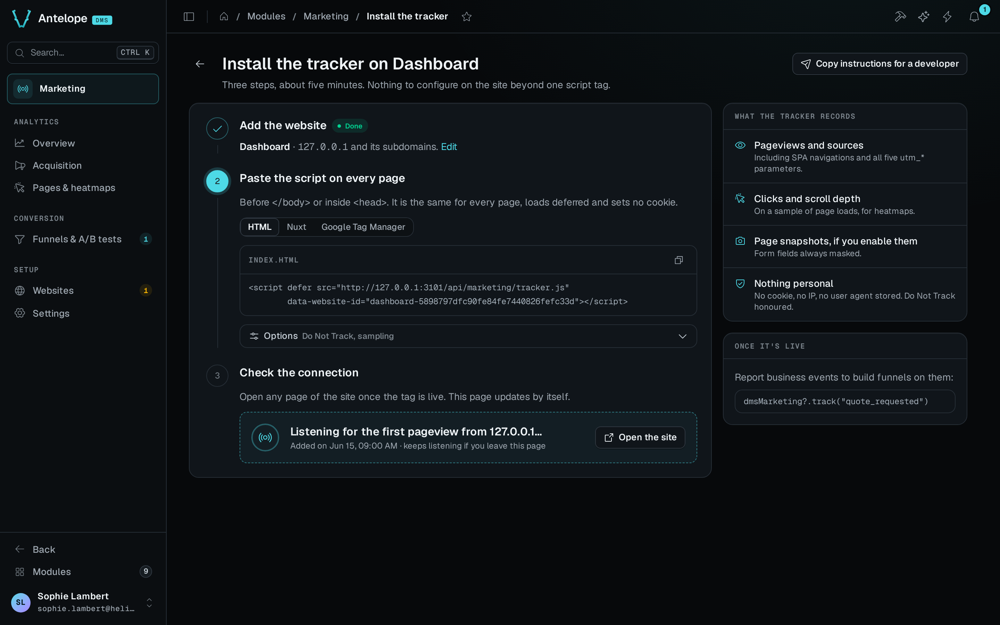

The module installs in two places. The DMS project hosts the backend and the admin pages, and each visitor-facing site you track gets one `<script>` tag. The last section runs the module's own development playground.

::note
Both packages are public on npm under the `@antelopejs` scope, like the DMS itself (`@antelopejs/dms`). They need no registry configuration or token.
::

## Install the module in the DMS project

### Requirements

- An AntelopeJS project that runs the DMS in a release that implements the `@antelopejs/interface-dms` range in the [module README compatibility table](https://github.com/AntelopeJS/dms-marketing/tree/main/packages/dms-marketing#compatibility). The DMS's `useApiData` reads the module's pages on the server. The project also loads the usual companions: `@antelopejs/mongodb`, `@antelopejs/api` and `@antelopejs/auth-jwt`. The module's tests run on `@antelopejs/mongodb`, which proves its conditional declaration writes and atomic import claims.
- The DMS console built with the `@antelopejs/dms-frontend` renderer in the range that `engines["@antelopejs/dms-frontend"]` of `frontend-vue/package.json` declares. The `ajs dms` CLI refuses to build the module with a renderer outside that range.
- MongoDB. The analytics data lives in the project's existing database deployment, in the DMS `dms-core` and `dms-tenant` schemas.

::warning
Upgrade the DMS backend and the renderer together, to the ranges above. See [DMS installation](/docs/getting-started/installation) for the toolchain and [Troubleshooting](/docs/building/troubleshooting) for dependency and frontend errors.
::

### Declare the module

Add the module with the AntelopeJS CLI:

```bash [Terminal]
ajs project modules add @antelopejs/dms-marketing
```

The entry lands in the project's `antelope.config.ts`, next to the `dms`, `mongodb`, `api` and `auth-jwt` entries of any DMS project. [Configuration](/docs/modules/marketing/configuration) describes every option. This example sets the one option that needs a file of your own, `geoipDatabasePath`:

```typescript [antelope.config.ts]
import { defineConfig } from "@antelopejs/interface-core/config";

export default defineConfig({
  name: "my-project",
  modules: {
    "dms-marketing": {
      source: {
        type: "package",
        package: "@antelopejs/dms-marketing",
        version: "^0.7.1",
      },
      config: {
        geoipDatabasePath: "/var/lib/geoip/GeoLite2-Country.mmdb",
      },
    },
  },
});
```

`geoipDatabasePath` is optional. It is the absolute path of a MaxMind country database (`.mmdb`) and turns on the visitor-country dimension. The module resolves the collect request's IP address locally at ingestion and stores only the country code. It ships no GeoIP data, so supplying the file is your licensing and compliance decision, whether GeoLite2 under its EULA or a commercial database. Replacing the file takes a restart.

### Behind a reverse proxy

The module identifies a visitor and rate-limits a source by the client address the DMS resolves (`getClientIp`). The DMS reads that address from the `auth.clientIpHeader` header when the hosting platform writes one. Otherwise it reads `X-Forwarded-For`, but only behind the number of reverse proxies its `auth.trustedProxies` option trusts. Set it to 1 behind one nginx, or to 2 behind a CDN and a load balancer.

If `auth.trustedProxies` stays at its default of 0 behind a proxy, every visitor looks like the proxy. Never set it higher than the number of proxies actually in front of the backend, because the client writes the entries past them.

### Upgrade from module version 0.3

Marketing 0.4 removed the module's own `trustedProxyHops` option. Move its value to the DMS's `auth.trustedProxies`, which now covers both.

The DMS reads an IPv4-mapped address (`::ffff:198.51.100.7`, as a backend that listens on IPv6 sees it) as plain IPv4. Visitors who reach the backend that way get a new visitor hash once, as on the monthly salt rotation. They count as new visitors and may draw another arm of a running A/B test.

### Allow the tracked sites' origins (CORS)

The built-in tracker needs no CORS grant for the visitor site. It sends beacons as `text/plain`, which needs no preflight, and it loads assignments as a script. Register the visitor site's host in the website's `domain` or `extraDomains` instead. The collect endpoint checks the host there and rejects a foreign one.

Authenticated console requests still use the `@antelopejs/api` CORS settings. When the console and the API have different origins, allow the console's origin:

```typescript fragment
api: {
  config: {
    cors: {
      allowedOrigins: ["https://dms.example.com"],
    },
  },
},
```

### Admin frontend

The module declares its admin pages on the backend, as trees of DMS blocks. The components it renders itself ship inside the package as a DMS frontend module, `frontend-vue/`. That Vue 3 project's root `dms.frontend.ts` declares the `DmsMarketing` component prefix and registers every component under it.

The module declares that frontend module through `AddFrontendModule`. The DMS frontend loader (`@antelopejs/dms-frontend`, CLI `ajs dms`) then builds it into the generated Inertia workspace. `ajs dms prepare` does so against a running backend, and `ajs dms dev` serves the console. Nothing else needs installing beside this package, because the backend serves the frontend module as an archive.

Once the console is up, the module appears in the sidebar as **Marketing**, with its pages under three headings:

- **Analytics** holds Overview, Acquisition, and Pages & heatmaps.
- **Conversion** holds Funnels & A/B tests.
- **Setup** holds Websites and Settings.

The funnel report, the funnel builder and the install guide are hidden pages that the others link to. The headings do not appear in the URLs. Every page lives at `/modules/marketing/<page>`.

The analytics pages render on the server. The context bar reads the websites first, so the blocks arrive with the page and its period. A URL that names no website redirects to the website you last picked. The frames of the page preview and the funnel builder still draw in the browser.

## Embed the tracker on a visitor site

Register the site first, from the install guide or from the [Websites](/docs/modules/marketing/usage/websites) page. The tag embeds the website's id.

Add one tag before `</body>` or in `<head>`. The install guide gives it in three forms: plain HTML, a Nuxt `app.head` entry and a Google Tag Manager custom HTML tag. **Copy instructions for a developer** copies it with a short note for whoever edits the site. The HTML form:

```html
<script defer src="https://<dashboard>/api/marketing/tracker.js"
        data-website-id="<website id>"></script>
```

The install guide builds the `src` from the API origin the dashboard talks to. When that origin is the dashboard's own, its frontend server (the `@antelopejs/dms-frontend` renderer) forwards only the backend routes declared to it. It also refuses a state-changing request from another origin unless the route is public. The module declares its three scripts (`tracker.js`, `experiments.js` and `snapshot.js`) and its two beacons (`collect` and `snapshot`) as `publicEndpoints`, which pass without a session. A tag that points at the backend's own origin works too.

The tag reads these optional attributes:

| Attribute | Effect |
| --- | --- |
| `data-host-url` | Overrides the collect origin. Defaults to the script's own origin. |
| `data-heatmap-sample` | Click and scroll sampling rate for this site, from 0 to 1. Overrides the module setting. |
| `data-do-not-track="false"` | Ignores the browser's Do Not Track and Global Privacy Control signals. |
| `data-exclude-paths` | Comma-separated pages left uncounted: `/x` (that page), `/x/*` (one segment below) or `/x/**` (the page and everything below). |

The tag stays live. If page code changes its `data-website-id`, the tracker sends what follows to that website. If page code removes the attribute, collection pauses until one is set again. To measure the DMS dashboard itself, you need no tag. See [Tracking the dashboard itself](/docs/modules/marketing/configuration#tracking-the-dashboard-itself).

Do not load the tag with `type="module"`. A module script has no `document.currentScript`, so the tracker cannot find its own attributes.

The tracker sets no cookie, batches events, and sends them with `sendBeacon`. It counts single-page navigations through `history.pushState`, `history.replaceState` and `popstate`. [Tracker & custom events](/docs/modules/marketing/usage/tracking) covers what it records and the JavaScript API it installs (`window.dmsMarketing.track(…)`). On a site that enables page snapshots, mark the elements that must never be captured. `data-dms-marketing-mask` masks an element's text, and `data-dms-marketing-block` replaces the element with an empty box. See [Pages & heatmaps](/docs/modules/marketing/usage/pages-and-heatmaps#what-is-and-is-not-captured).

### Verify



The screenshot shows a local playground, not a verified production connection. Use the snippet that the install guide generates for your own website and dashboard.

Step 3 of the install guide checks the connection by itself. While it waits, it polls `GET /api/marketing/websites/:id/connection` every 4 seconds. It turns green once a pageview stored since the site's creation arrives, and it shows the pageview's date and time, its path, its browser and its device. It also shows the host the pageview came from, when this backend instance saw it.

**Check again** waits for a pageview sent after the click (`?since=<epoch ms>`), to verify a site that is already live. A banner says when collection is paused for the whole module or for the site.

A beacon refused because its host is not declared shows as *N events refused from `<host>`* instead, with an **Allow this host** button. The button adds the host to the website's `extraDomains` (`POST /api/marketing/websites/:id/allow-host`). Each backend instance counts refusals in memory, for an hour and for at most 5 hosts per site. That is enough for a page that polls while someone installs the tag, and it is not an audit trail. The **Websites** page shows the same refused hosts on the site's card, whatever its state.

To verify by hand, follow these steps:

1. Load the site with the browser's network tab open. The tracker script loads from the backend, and `POST /api/marketing/collect` answers **200**. A **403** means the page's host is not among the website's `domain` and `extraDomains`. A **404** means the website id is unknown or the site's **Collect data** switch is off. While collection is paused in [Settings](/docs/modules/marketing/usage/settings), the script is a stub that does nothing and the collect answer reports every event as `dropped`.
2. Within a minute, the page appears on `/modules/marketing/pages`, the overview counts the visit, and the context bar reads *Live · last event …* for the site.

## Run the development playground

The repository ships a full consumer project under `packages/dms-marketing/playground/`. It runs the backend on port 5010, the DMS console through `ajs dms dev`, and a demo site under `http://localhost:5010/demo`.

The demo site is a small tracked multi-page site with pricing, signup, a single-page navigation, custom events, a prefilled form and masked elements. Its tag sets `data-heatmap-sample="1"`, so every capture path runs on every visit instead of on a sample. Its pages refuse framing (`X-Frame-Options: DENY`), as production sites do. The heatmap backdrop therefore comes from page snapshots, which the seeded website enables, as on real sites.

Run these commands from the repository root. The playground is not a workspace package, so it needs its own install:

```bash [Terminal]
pnpm install
pnpm build                       # the interface, then the module
cd packages/dms-marketing/playground
pnpm install --ignore-workspace  # its own lockfile, outside the workspace
pnpm dev                         # backend on :5010 (ajs project run -w)
pnpm frontend:dev                # DMS console (ajs dms dev), in a second terminal
```

::warning
Keep `zod` on `~3.24.x`, the range pinned in `package.json`. The DMS builds its shared types, such as data-api column schemas and declarative forms, against zod 3.24. Zod 3.25 changes the internal type structure they rely on. A routine bump typechecks this module on its own and breaks it against the DMS. The tilde range can move only after `@antelopejs/dms` moves.
::

The playground expects a local MongoDB on `mongodb://localhost:27017`, with the database `playground-dms-marketing`. The `MONGO_URL` environment variable overrides the server, as in `MONGO_URL=mongodb://127.0.0.1:27117 pnpm dev`. The playground allows CORS for the dev console on port 3001, and for `DMS_CLIENT_BASE_URL` when you set it. It loads the DMS, its storage and mail companions, and this module.

The demo pages embed a fixed `data-website-id`, so the playground seeds their website row itself. It does so in a `TENANT_BEING_PROVISIONED` hook, when the DMS provisions the default tenant on a fresh database (`playground/src/seed.ts`). The same hook seeds a demo dataset (`playground/src/demo-data.ts`) so that every page has something to show. The dataset holds three websites of the default tenant: a busy shop, a quieter docs site, and one still waiting for its first pageview. It adds 120 days of daily rollups, 30 days of raw events behind funnels, an A/B test and a heatmap, and a page snapshot to draw the heatmap on. Start with `DMS_MARKETING_DEMO=0` to skip the dataset. Funnels over the demo site's own journey are ordinary definitions you create from the console, such as `/demo`, then `/demo/pricing`, then `/demo/signup`, then the custom event `signup_submitted`.

These commands check the code from the repository root:

- `pnpm lint` runs oxlint over the workspace, ESLint over `frontend-vue/`, and the locale, docs-version and interface-range checks.
- `pnpm typecheck` runs `tsc` over both packages.
- `pnpm knip` reports unused dependencies.
- `pnpm test` runs the frontend module's vitest suite. `pnpm --dir packages/dms-marketing test:backend` runs the backend suite against a real DMS.
- `pnpm run checks` runs typecheck, lint, format, knip, tests, size, suppressions and sync.
