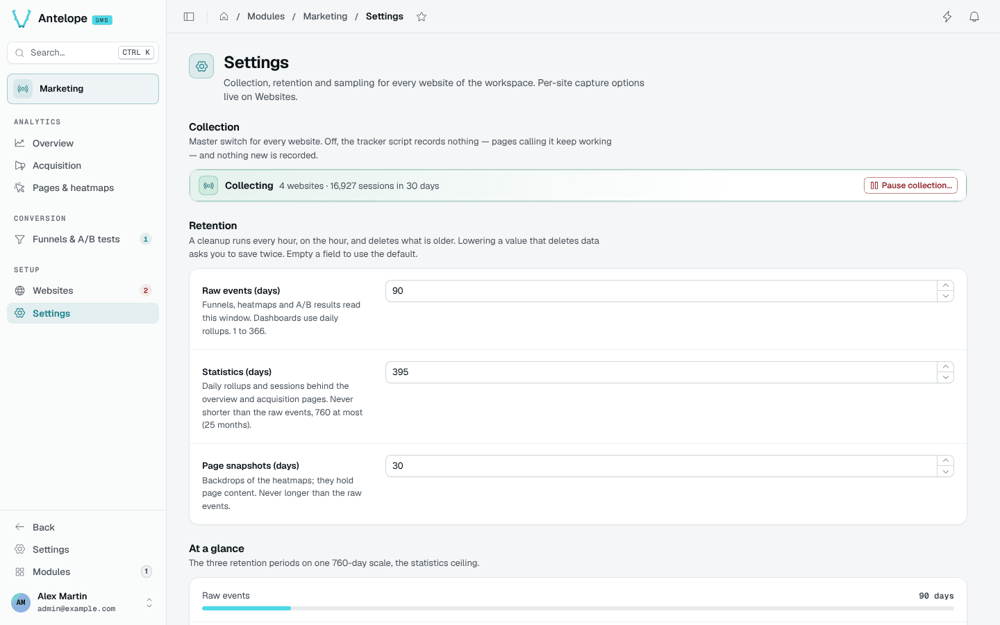

# Configuration

The module reads its defaults from its `antelope.config.ts` entry. The Settings page overrides some of them at runtime, for the whole deployment, without a restart.

```typescript [antelope.config.ts]
"dms-marketing": {
  source: { type: "package", package: "@antelopejs/dms-marketing", version: "^0.6.0" },
  config: {
    geoipDatabasePath: "/var/lib/geoip/GeoLite2-Country.mmdb",
  },
},
```

## Module options

| Option | Type | Default | Description |
| --- | --- | --- | --- |
| `trackerEnabled` | `boolean` | `true` | Master collection switch. Off, the tracker becomes a no-op stub and the collect endpoint drops every event. Overridable from Settings. |
| `rawEventsRetention` | `number` (ms) | 90 days | How long raw events are kept. They back heatmaps, funnels and A/B results. Overridable from Settings (1 to 366 days). |
| `statisticsRetention` | `number` (ms) | 395 days | How long daily rollups and sessions are kept. Never shorter than the raw events, at most 760 days. Overridable from Settings. |
| `snapshotRetention` | `number` (ms) | 30 days | How long page snapshots are kept. Never longer than the raw events. Overridable from Settings. |
| `snapshotMaxBytes` | `number` (bytes) | 1 MiB | Cap on one page snapshot upload, measured compressed (gzip) where the browser compresses it. Clamped to 64 KiB – 8 MiB, which keeps a stored snapshot well under MongoDB's 16 MiB document limit. A page past it gets no backdrop and the preview says so. |
| `sessionIdleTimeout` | `number` (ms) | 30 minutes | Inactivity after which a session ends. |
| `heatmapSampleRate` | `number` (0 to 1) | `0.1` | Share of page loads that record clicks, scrolls and snapshots. A site's `data-heatmap-sample` attribute overrides it. Overridable from Settings. |
| `visitorHashSecret` | `string` | generated | Feeds the visitor-hash salt. Empty uses a secret generated and persisted at first start; set it explicitly when running several instances. |
| `geoipDatabasePath` | `string` | empty | Absolute path of a MaxMind country database (`.mmdb`). Enables the visitor-country dimension: the IP is resolved locally at ingestion and only the country code is stored. Without it, only sessions imported with a `country` have one, and the overview lists them. The module ships no GeoIP data; supplying the file is your licensing decision. Replacing the file takes a restart. |
| `dashboardTracking` | `object` | off | Measures the dashboard's own pages, without writing a tag. See [Tracking the dashboard itself](#tracking-the-dashboard-itself). |

## Tracking the dashboard itself

A demo, a playground or a back office that wants the usage of its own admin
in Marketing turns on `dashboardTracking`. No frontend code is written: the
module loads its tracker on every dashboard page through its own frontend
layer.

```typescript [antelope.config.ts]
"dms-marketing": {
  source: { type: "package", package: "@antelopejs/dms-marketing", version: "^0.6.0" },
  config: {
    dashboardTracking: {
      enabled: true,
      websiteName: "Dashboard", // optional
      excludePaths: ["/settings/**"], // optional
      snapshots: true, // optional, off by default
    },
  },
},
```

| Key | Type | Default | Description |
| --- | --- | --- | --- |
| `enabled` | `boolean` | `false` | Only `true` turns it on. Off, nothing is provisioned, the dashboard loads no tracker and the module registers its frontend exactly as without the option. |
| `websiteName` | `string` | `"Dashboard"` | Name the website gets when it is created (at most 100 characters). A website that already exists keeps its own: rename it on the Websites page. |
| `excludePaths` | `string[]` | `[]` | Dashboard pages left uncounted, beside the sign-in pages: `/x` (that page), `/x/*` (one segment below) or `/x/**` (the page and everything below). Other values are ignored. |
| `snapshots` | `boolean` | `false` | Page snapshots on the dashboard's website, so its click heatmaps are drawn over the pages themselves. Only `true` enables them. A capture stores what an admin page shows, so its text is masked (form values always are). The value applies when the website is created, and later while nobody changed the switch: once someone turns snapshots on or off on the Websites page (or over the API), their choice stands and the option no longer touches it. |

What it does:

- **One website per workspace, created on first use.** The first time
  someone signed in opens the dashboard, the module creates a website for
  their workspace (tenant), named `websiteName`, with the host the
  dashboard answered on as its domain. Its id derives from the tenant, so
  every instance and every tab agrees on it and a second visit creates
  nothing. A host the dashboard is later opened from (a staging name next
  to `localhost`) joins its extra hosts, up to the 20-host cap. It shows up
  on the [Websites](/docs/modules/marketing/usage/websites) page like any
  other: rename it, pause it (**Collect data**) or delete it — a deleted one
  comes back on the next dashboard visit while the option is on.
- **Signed-in pages only.** The tracker loads once someone is signed in and
  pauses as soon as they sign out; a workspace switch moves it to the new
  workspace's website without a reload, so no page of one workspace reaches
  another's. The sign-in pages (`/auth/**`, the account switcher included)
  are never counted, whatever `excludePaths` says. During an identity
  transition, new events are dropped until the tag is retargeted; the old
  queue is still sent under its original website.
- **SPA navigations count.** The dashboard navigates without reloading; the
  tracker counts each page it lands on, like on any single-page site
  ([Tracker](/docs/modules/marketing/usage/tracking#what-is-recorded-automatically)).
- **The module's promises hold.** First-party (the tracker and its beacons
  stay on the dashboard's own origin), cookieless, no IP or user agent
  stored, Do Not Track and Global Privacy Control honoured. Pages are not
  tied to the account browsing them by the collector: it does not use the
  authenticated account, and visitors use the same monthly rotated hashes
  as on any site. Page snapshots default to off on this website, but an owner
  can enable them through the ordinary website settings. This is not a
  server-enforced prohibition: a capture of an admin page would store the
  records it shows, so leave snapshots off.
- **Workspaces stay apart, except for the platform owner.** Each
  workspace's data lives in its own tenant and a workspace owner only ever
  sees their own. On an install with several workspaces, a platform owner
  can read the dashboard's heatmaps of another workspace, or of all of them
  combined, from the Pages & heatmaps view
  ([Reading another workspace's dashboard](/docs/modules/marketing/usage/pages-and-heatmaps#reading-another-workspaces-dashboard)):
  read-only, with snapshots always text-masked. It works the same with or
  without dms-saas: the workspaces come from the DMS core.

The dashboard's frontend reads the option when it starts: after turning it
on or off, restart `ajs dms dev` or rebuild the frontend (`ajs dms build`).
The module-wide switch (`trackerEnabled`, Settings) pauses it like every
other site.

## Settings from other modules

| Module | Setting | Why |
| --- | --- | --- |
| `dms` | `auth.trustedProxies` | Number of reverse proxies in front of the backend. The module identifies visitors and rate-limits sources by the client address the DMS resolves; left at 0 behind a proxy, every visitor looks like the proxy. Never set it higher than the proxies actually there. |
| `api` | `cors.allowedOrigins` | Only the console origins need it. The tracker posts `text/plain`, a CORS-safelisted type, and the backend gates on the browser's `Origin` against each website's domains. |

::warning
**Upgrading from 0.3.** The module's own `trustedProxyHops` option is gone: move its value to the DMS's `auth.trustedProxies`.
::

## Runtime settings

The [Settings](/docs/modules/marketing/usage/settings) page edits the collection switch, the three retentions and the heatmap sampling for every tenant and website. A field left empty follows the config default above. Per-site options (page snapshots, text masking, extra hosts, collect data) live in each website's drawer on the [Websites](/docs/modules/marketing/usage/websites) page.


