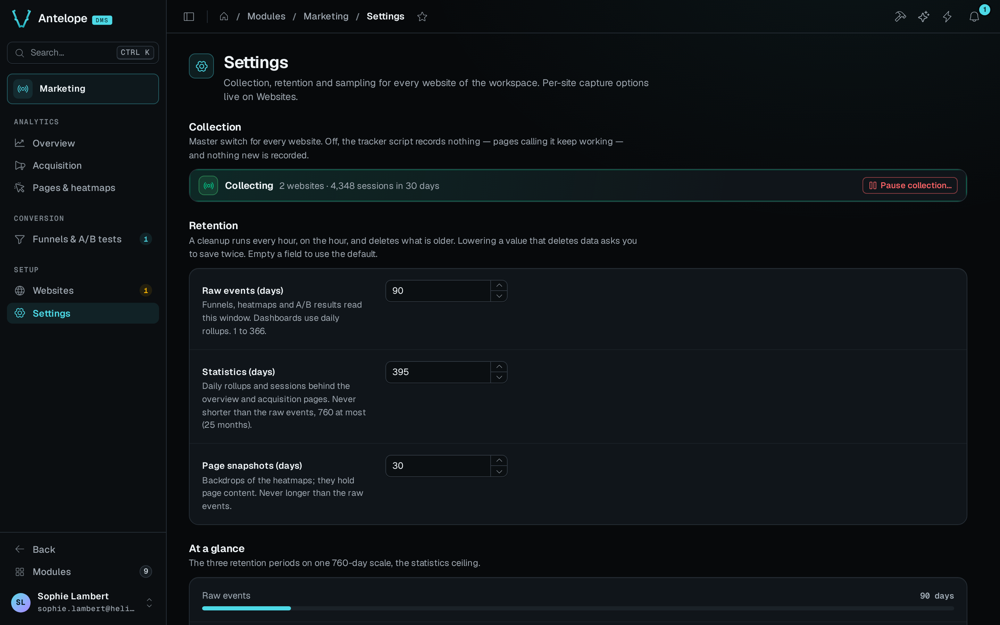

The module reads its defaults from its `antelope.config.ts` entry. The **Settings** page overrides some of them at runtime, for the whole deployment, without a restart. Every option is optional.

```typescript fragment [antelope.config.ts]
"dms-marketing": {
  source: { type: "package", package: "@antelopejs/dms-marketing", version: "^0.8.0" },
  config: {
    geoipDatabasePath: "/var/lib/geoip/GeoLite2-Country.mmdb",
  },
},
```

## Module options

| Option | Type | Default | Description |
| --- | --- | --- | --- |
| `trackerEnabled` | `boolean` | `true` | Collection switch for the whole module. Off, the tracker is a stub that does nothing and the collect endpoint drops every event. Settings overrides it. |
| `rawEventsRetention` | `number` (ms) | 90 days | How long the module keeps raw events. Heatmaps, funnels and A/B results read them. Settings overrides it, from 1 to 366 days. |
| `statisticsRetention` | `number` (ms) | 395 days | How long the module keeps daily rollups and sessions. Settings overrides it, from 1 to 760 days, and refuses a value shorter than the raw-events retention. |
| `snapshotRetention` | `number` (ms) | 30 days | How long the module keeps page snapshots. The hourly cleanup never keeps a snapshot longer than the raw events. Settings overrides it, from 1 to 366 days, and refuses a value longer than the raw-events retention. |
| `snapshotMaxBytes` | `number` (bytes) | 1 MiB | Cap on one page snapshot upload, measured compressed (gzip) when the browser compresses it. The module clamps it between 64 KiB and 8 MiB, which keeps a stored snapshot well under the 16 MiB document limit of MongoDB. A page past the cap gets no backdrop, and the preview says so. |
| `sessionIdleTimeout` | `number` (ms) | 30 minutes | Inactivity after which a session ends. |
| `heatmapSampleRate` | `number` (0 to 1) | `0.1` | Share of page loads that record clicks, scrolls and snapshots. The `data-heatmap-sample` attribute of a site's tag overrides it for that site. Settings overrides it, from 0 to 100%. |
| `visitorHashSecret` | `string` | generated | Feeds the salt of the visitor hash. Empty, the module uses a secret it generates and stores at first start. Set it explicitly when you run several instances. |
| `geoipDatabasePath` | `string` | empty | Absolute path of a MaxMind country database (`.mmdb`). It turns on the visitor-country dimension. The module resolves the IP address locally at ingestion and stores only the country code. Without it, only sessions imported with a `country` have one, and the overview lists those. The module ships no GeoIP data, so supplying the file is your licensing decision. Replacing the file takes a restart. |
| `dashboardTracking` | `object` | off | Measures the dashboard's own pages without a tag. See [Tracking the dashboard itself](#tracking-the-dashboard-itself). |

## Tracking the dashboard itself

`dashboardTracking` measures the usage of the dashboard's own pages in Marketing, for a demo, a playground or a back office. It needs no frontend code. The module loads its tracker on every dashboard page through its own frontend module.

```typescript fragment [antelope.config.ts]
"dms-marketing": {
  source: { type: "package", package: "@antelopejs/dms-marketing", version: "^0.8.0" },
  config: {
    dashboardTracking: {
      enabled: true,
      websiteName: "Dashboard",
      excludePaths: ["/settings/**"],
      snapshots: true,
    },
  },
},
```

| Key | Type | Default | Description |
| --- | --- | --- | --- |
| `enabled` | `boolean` | `false` | Only `true` turns it on. Off, the module provisions nothing, the dashboard loads no tracker, and the module registers its frontend exactly as without the option. |
| `websiteName` | `string` | `"Dashboard"` | Name of the website when the module creates it, at most 100 characters. A website that already exists keeps its own name. Rename it on the **Websites** page. |
| `excludePaths` | `string[]` | `[]` | Dashboard pages left uncounted, beside the sign-in pages and the module area, which are always excluded. Each value is `/x` (that page), `/x/*` (one segment below) or `/x/**` (the page and everything below). The module ignores other values. |
| `snapshots` | `boolean` | `false` | Page snapshots on the dashboard's website, so its click heatmaps draw over the pages themselves. Only `true` enables them. The website masks the text of every capture, because a capture stores what an admin page shows. Form values are never captured. The value applies when the module creates the website, and later while nobody has changed the switch. Once someone turns snapshots on or off on the **Websites** page or over the API, their choice stands and the option no longer changes it. When the option does change the switch, the module discards the site's snapshots, as an owner's change does. |

The option behaves as follows:

- **One website per workspace, created on first use.** The first time a signed-in user opens the dashboard, the module creates a website for their workspace (tenant). The website is named `websiteName`, and its domain is the host the dashboard answered on. Its id derives from the tenant, so every instance and every tab computes the same id and a second visit creates nothing. A host the dashboard is later opened from, such as a staging name next to `localhost`, joins the website's extra hosts, up to the cap of 20. The website shows on the [Websites](/docs/modules/marketing/usage/websites) page like any other. You can rename it, pause it with **Collect data**, or delete it. A deleted one comes back on the next dashboard visit while the option is on.
- **Signed-in pages only.** The tracker loads once someone signs in and pauses as soon as they sign out. A workspace switch moves it to the new workspace's website without a reload, so no page of one workspace reaches another's website. The sign-in pages (`/auth/**`, the account switcher included) are never counted, whatever `excludePaths` says. During an identity change, the tracker drops new events until it points at the new website. It still sends the old queue under its original website.
- **The module area is never counted.** Dashboard tracking measures the product you build, not the modules that AntelopeJS or the community ship. The modules page (`/modules`), the module store (`/modules/store`) and every page a module mounts (`/modules/<module>/...`) send no pageview, click, scroll depth, snapshot or custom event, whatever `excludePaths` says. The collector refuses those paths too, so an older tag or a hand-made beacon cannot add any. To measure a module of your own, track the pages of the site that uses it. The rule applies to the dashboard's website only, so another site with its own `/modules` page is counted as usual.
- **Single-page navigations count.** The dashboard navigates without reloading, and the tracker counts each page it lands on, as on any single-page site ([Tracker](/docs/modules/marketing/usage/tracking#what-is-recorded-automatically)).
- **The module's privacy rules still apply.** The tracker loads from the API origin the dashboard already talks to. It sets no cookie, the backend stores no IP address or user agent, and the tracker honours Do Not Track and Global Privacy Control. The collector does not tie pages to the account that browses them. It ignores the authenticated account, and visitors get the same monthly rotated hashes as on any site. Page snapshots are off by default on this website, but an owner can turn them on in the ordinary website settings. The server does not forbid it. Leave snapshots off, because a capture of an admin page stores the records it shows.
- **Workspaces stay apart, except for the platform owner.** Each workspace's data lives in its own tenant, and a workspace owner sees only their own. On an install with several workspaces, a platform owner can read the dashboard heatmaps of another workspace, or of all of them combined, from the **Pages & heatmaps** view ([Reading another workspace's dashboard](/docs/modules/marketing/usage/pages-and-heatmaps#reading-another-workspaces-dashboard)). That view is read-only, and its snapshots are always text-masked. It works the same with or without `dms-saas`, because the workspaces come from the DMS core.

The dashboard's frontend reads the option when it starts. After you turn it on or off, restart `ajs dms dev` or rebuild the frontend with `ajs dms build`. The collection switch of the whole module (`trackerEnabled`, on the **Settings** page) pauses it like every other site.

## Settings from other modules

| Module | Setting | Why |
| --- | --- | --- |
| `dms` | `auth.trustedProxies` | Number of reverse proxies in front of the backend. The module identifies visitors and rate-limits sources by the client address the DMS resolves. At 0 behind a proxy, every visitor looks like the proxy. Never set it higher than the number of proxies actually there. It replaces the module's own `trustedProxyHops` option, which Marketing 0.4 removed. |
| `dms` | `auth.clientIpHeader` | Header the hosting platform writes with the client address. When it is set, the DMS reads the client address from it instead of counting proxies. |
| `api` | `cors.allowedOrigins` | Only the console origins need it. The tracker posts `text/plain`, a CORS-safelisted type, and the backend checks the browser's `Origin` (or `Referer`) against each website's domains. |

## Runtime settings

The [Settings](/docs/modules/marketing/usage/settings) page edits the collection switch, the three retentions and the heatmap sampling, for every tenant and website. A field left empty follows the config default above. Per-site options live in each website's settings on the [Websites](/docs/modules/marketing/usage/websites) page: page snapshots, text masking, extra hosts and **Collect data**.


