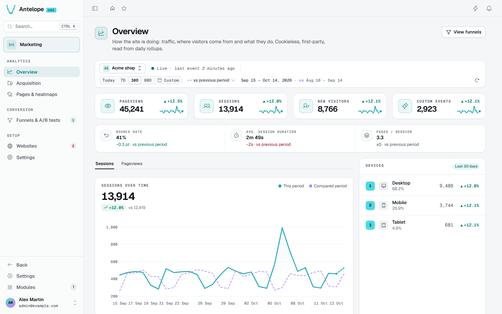

# Overview dashboard

**Where:** `/modules/marketing/overview` — the module's landing page, first
under the **Analytics** heading.

The overview answers "how is the site doing" for one website over a chosen
period: traffic volume, where visitors come from, and what they use.

## The context bar

Every analytics page (Overview, Acquisition, Pages & heatmaps, Funnels and
a funnel's report) opens on the same bar, the DMS page toolbar every page
with a period or live data shows: the website on the left, then when the
page was last updated, **Direct / Pause** and the period on the right, on one
line at desktop width. Every block of the page reads what it picks:

- **Website** — beside the switcher, a dot and the age of the site's last
  event (*12 sec ago*, *just now* under 5 seconds — never a time ahead,
  even when the server's clock runs ahead of the browser's; *Waiting*,
  *Paused* without one), the full state in its tooltip. The switcher lists the workspace's sites with their state:
  *Live · last event …* while its last event is under 5 minutes old, *Last
  event …* once it has gone quiet, *Waiting for the first
  event* before that, *Tracking paused for this website* when the site's own
  switch is off. A site whose data all comes from an
  [import](/docs/modules/marketing/extending) reads *Imported history · last
  event …* until the tag sends something newer. The pick is also stored server-side per member, as the
  site of the pages opened without one. Until you pick one, the most
  recently active site is shown.
- **Period** — 1D (today), 7D, 30D, 90D or a custom range picked from the
  calendar segment;
  30 days by default. The bar reads when the window starts (*since Sep 16*),
  or its dates once it has ended. `MAX_QUERY_PERIOD_DAYS` (90) bounds every
  window: a longer range is cut at its start, which the bar says.
  Statistics are counted per UTC day; the website state's tooltip says
  when your days start.
- **Comparison** — the previous period (default), the same period a year
  earlier, or none, chosen in the dropdown beside the period (*vs previous
  period ⌄*), in the calendar's popover (*Compare to*) or in the URL. Every
  change, comparison curve and label of the page follows it (*vs previous
  year*); with *No comparison* the changes are left out, not shown as 0.
- **Direct / Pause** — in Direct, the page follows what the tracker sends:
  each batch of events (or a page snapshot) makes its blocks read again, at
  most every 15 seconds over a week or less and every minute over longer
  periods, and the bar says how long ago the page was updated. **Pause**
  freezes every block as it is (the period too): the bar counts what came
  in (*12 new*), a table keeps its rows with a *12 new events · Show* strip,
  and **Direct** reads what missed anything. The **L** key switches it, and
  the choice follows you from one analytics page to the next.

### What moves live

Every figure is read from what ingestion stores as the events arrive:

- **Moves with each batch** — today's counts in the KPI cards, the session
  quality strip and the channel split; the current day (or hour, on 1D) of
  the traffic curve; the top lists, devices and campaigns; the website's
  last event in the bar; on Pages & heatmaps the page list, click and
  scroll counts; on Funnels and a funnel's report the entered and converted
  sessions and an A/B test's arms. The funnel figures are computed from the
  raw events and the list keeps them up to 30 seconds.
- **Daily aggregates** — the days before today are rollups closed with their
  UTC day: they no longer change, so a period that ended reads the same in
  Direct as paused. The comparison of today's partial day is read with the
  same elapsed share of the matching day, again at each read.
- **Static** — how a session gets its channel (Acquisition) is a fixed
  table, not data.

On a multi-workspace DMS, arrivals in another workspace also wake the page:
the DMS does not yet scope a realtime topic to one workspace, so the
blocks read again (within the same rate) and the paused count includes
them, with nothing of their data shown.

The website, period and comparison are in the page URL
(`?website=…&marketing.period=…&marketing.compare=…`), so a copied link opens
on the same view and each tab keeps its own. Links between the module's
pages carry them; a page opened from the sidebar starts from your last
choice on it. While the workspace has no website, a first-run screen with
**Add a website** replaces the page's blocks.

## What it shows

- **KPI cards** — pageviews, sessions, new visitors and custom events for
  the period, each with its change against the comparison window and a
  daily sparkline.
- **Session quality** — **bounce rate** (share of sessions that never passed
  one pageview; its change reads in points, and a decrease reads as the good
  direction), **average session duration** (observed activity span — last
  beacon minus first) and **pages per session**.
- **Traffic chart** — sessions per day, the comparison window drawn dashed
  behind the period.
- **Devices** — sessions by device type, with their share.
- **Top lists** — four tabbed cards, each footer leading to the surface that
  owns the detail:
  - **Content** — top pages, **entry pages** (first page of each session)
    and **exit pages** (last page seen so far — it follows the session while
    it lives); a click on a page opens its heatmap on
    [Pages & heatmaps](/docs/modules/marketing/usage/pages-and-heatmaps).
  - **Acquisition** — **channels** (the direct / organic / social / email /
    referral / paid split), **campaigns** and **referrers**; the footer opens
    the [Acquisition page](/docs/modules/marketing/usage/acquisition).
  - **Audience** — browsers and **languages** (as the visitors' browsers
    report them, shown as readable names). A **Countries** tab joins them
    when the deployment configures a GeoIP database (`geoipDatabasePath`,
    see [Installation](/docs/modules/marketing/installation#declare-the-module)): the country is
    derived from the IP at collection and stored as a code — the IP itself
    never is. Without one, the tab still shows when the period has sessions
    with a country, such as history imported with `ImportAnalytics`.
  - **Custom events** — custom event names ranked by trigger count, the
    breakdown behind the custom-events KPI ([Tracker & custom events](/docs/modules/marketing/usage/tracking)). An
    event that is the last step of a funnel of the site is tagged **Goal**;
    the footer opens the funnel builder.

  Everything is ranked over the selected period.

The header's **View funnels** action leads to
[Funnels & A/B tests](/docs/modules/marketing/usage/funnels).

## Where the numbers come from

Every panel reads the **daily rollups** (`marketing_website_statistics`),
never raw events — the dashboard stays fast regardless of traffic volume, and
keeps working after raw events expire. A few consequences worth knowing:

- **Periods are whole days, in UTC.** The bounds the context bar sends are
  mapped on the UTC days carrying the same dates, which is what rollup rows
  are keyed on.
- **Top lists are capped.** A day keeps at most `MAX_ENTRIES_PER_TOP_MAP` (50)
  entries per list. Top maps are emptied after `TOP_MAPS_RETENTION_DAYS`
  (455 days), allowing a 90-day window to be compared with the previous year
  when the configured statistics retention still covers it. Scalar counters
  follow that statistics retention. Totals are exact; long-tail entries in
  top lists are not.
- **Referrers are acquisition sources, not navigation.** A referrer matching
  the website's `domain` — or any hostname the batch was tracked from — is
  dropped at ingestion, never counted as a source.
- **Counters added later start at their ship date.** Rollup days written
  before bounce, duration or the entry/exit and events dimensions existed
  read as zero for them; a window overlapping that boundary understates
  those metrics, never the traffic ones.

See [Architecture](/docs/modules/marketing/architecture) for how the rollups are written.
