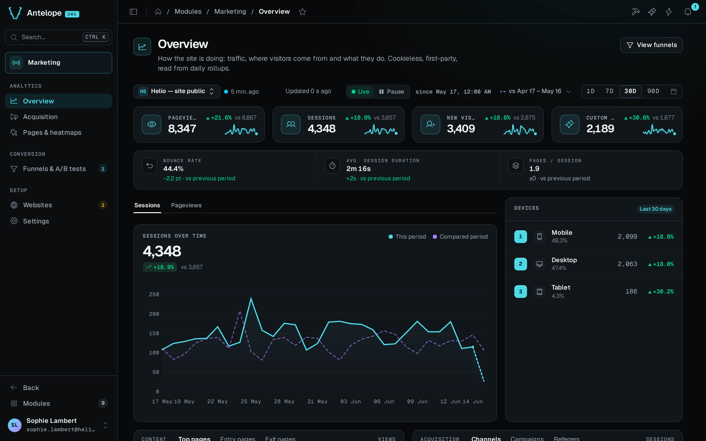

The overview is the module's landing page, at `/modules/marketing/overview`, first under the **Analytics** heading of the sidebar. It shows how one website is doing over a chosen period. You see its traffic volume, where its visitors come from, and what they use.

## The context bar

Every analytics page opens on the same bar. These pages are Overview, Acquisition, Pages & heatmaps, Funnels and a funnel's report. The bar is the DMS page toolbar. It holds the website on the left, then the time of the page's last update, the **Live** and **Pause** toggle, and the period. Every block of the page reads the website and the period the bar picks.

### Website

Beside the website switcher, a dot and a short label give the age of the site's last event, such as *12 sec ago*. The label reads *just now* under 5 seconds, and also when the server's clock runs ahead of the browser's. A site without an event reads *Waiting* or *Paused*. The tooltip gives the full state.

The switcher lists the workspace's websites, most recently active first, each with its state:

- *Live · last event …* while the last event is under 5 minutes old.
- *Last event …* once the site has gone quiet.
- *Waiting for the first event* before the site sends anything.
- *Tracking paused for this website* while the site's **Collect data** switch is off.
- *Imported history · last event …* while all of the site's data comes from an [import](/docs/modules/marketing/extending), until the tag sends something newer.

Your pick is saved on the server, per member. A page opened without a website in its URL opens on that pick. Until you pick one, the page opens on the most recently active website.

### Period

The period is **1D** (today), **7D**, **30D**, **90D** or a custom range from the calendar. The default is 30 days. The bar shows when the window starts (*since Sep 16*), or its dates once it has ended. `MAX_QUERY_PERIOD_DAYS` (90) bounds every window. A longer range is cut at its start, and the bar says *Only the last 90 days of this range are shown*.

Statistics are counted per UTC day. The website's tooltip gives the time your days start in your own time zone.

### Comparison

The comparison is the previous period (the default), the same period a year earlier, or none. You choose it in the dropdown beside the period (*vs previous period*), under **Compare to** in the calendar, or in the URL. Every change, comparison curve and label on the page follows it (*vs previous year*). With **No comparison**, the page leaves the changes out instead of showing 0.

### The live toggle

In **Live**, the page follows what the tracker sends. Each batch of events, and each page snapshot, makes the blocks read their data again. The page reads at most every 15 seconds for a period of a week or less, and at most every minute for a longer period. The bar shows how long ago the page was updated.

**Pause** freezes every block as it is, the period included. The bar counts what came in since (*12 new*). A table keeps its rows and shows a *12 new events · Show* strip. Switching back to **Live** reads everything the page missed. The **L** key switches between the two modes. The choice follows you from one analytics page to the next.

Arrivals are published per workspace. A page wakes, and counts arrivals while paused, only for events of its own workspace.

### What moves live

Every figure comes from what ingestion stores as the events arrive. The figures fall into three groups.

- **Figures that move with each batch.** These are today's counts in the KPI cards, the session quality strip and the channel split. They also include the current day of the traffic curve (the current hour on **1D**), the top lists, devices and campaigns, and the website's last event in the bar. On Pages & heatmaps, the page list and the click and scroll counts move. On Funnels and a funnel's report, the entered and converted sessions and the arms of an A/B test move. The funnel figures are computed from raw events, and the funnel list keeps them for up to 30 seconds.
- **Daily aggregates.** The days before today are rollups, closed with their UTC day. They no longer change, so a period that has ended reads the same in **Live** as in **Pause**. The comparison of today's partial day uses the same elapsed share of the matching day, recomputed at each read.
- **Static content.** The rules that give a session its channel, on Acquisition, are a fixed table, not data.

### The context in the URL

The website, the period and the comparison are in the page URL (`?website=…&marketing.period=…&marketing.compare=…`). A copied link opens on the same view, and each browser tab keeps its own. Links between the module's pages carry the context with them.

While the workspace has no website, a first-run screen with **Add a website** replaces the page's blocks. While the selected website has not received its first event, the overview shows the way to its install guide instead of its blocks.

## What the overview shows

The overview has these blocks:

- **KPI cards.** Pageviews, sessions, new visitors and custom events for the period. Each card shows its change against the comparison window and a daily sparkline.
- **Session quality.** **Bounce rate** is the share of sessions with a single pageview. Its change reads in percentage points, and a decrease reads as the good direction. **Avg. session duration** is the observed activity time of a session. It sums the gaps between the session's batches of events and leaves out gaps past the idle timeout. **Pages / session** is pageviews divided by sessions.
- **Traffic chart.** Two tabs, **Sessions** and **Pageviews**. Each draws the period by day, or by hour over a single day, with the comparison window dashed behind it.
- **Devices.** Sessions by device type, with their share.
- **Top lists.** Four tabbed cards, ranked over the selected period:
  - **Content** lists **Top pages**, **Entry pages** (the first page of each session) and **Exit pages** (the last page seen so far, which follows the session while it lasts). A click on a page opens its heatmap on [Pages & heatmaps](/docs/modules/marketing/usage/pages-and-heatmaps). The footer opens that page.
  - **Acquisition** lists **Channels** (the Direct, Organic search, Social, Email, Referral and Paid split), **Campaigns** and **Referrers**. The footer opens the [Acquisition page](/docs/modules/marketing/usage/acquisition).
  - **Audience** lists **Browsers** and **Languages**, as the visitors' browsers report them, shown as readable names. A **Countries** tab joins them when the period has sessions with a country. A session gets a country when the deployment configures a GeoIP database (`geoipDatabasePath`, see [Installation](/docs/modules/marketing/installation#declare-the-module)), or when imported history declares one with `ImportAnalytics`. The country is derived from the IP at collection and stored as a code. The IP itself is never stored. This card has no footer.
  - **Custom events** ranks custom event names by trigger count. It breaks down the custom-events KPI, see [Tracker & custom events](/docs/modules/marketing/usage/tracking). An event that is the last step of one of the site's funnels carries a **Goal** tag. The footer opens the funnel builder.

The header's **View funnels** action opens [Funnels & A/B tests](/docs/modules/marketing/usage/funnels).

## Where the numbers come from

Every panel reads the daily rollups (`marketing_website_statistics`), never raw events. The dashboard stays fast whatever the traffic volume, and keeps working after raw events expire. Reading rollups has these consequences:

- **Periods are whole UTC days.** The bounds the context bar sends map to the UTC days that carry the same dates. Rollup rows are keyed on those days.
- **Top lists are capped.** A day keeps at most `MAX_ENTRIES_PER_TOP_MAP` (50) entries per list. The retention prune empties top lists after `TOP_MAPS_RETENTION_DAYS`, a year plus 90 days (455 days). That is long enough to compare a 90-day window with the previous year, when the configured statistics retention still covers it. Scalar counters follow the statistics retention. Totals are exact. The long tail of a top list is not.
- **Referrers are acquisition sources, not navigation.** Ingestion drops a referrer that matches the website's `domain`, or any hostname the batch was tracked from. It never counts as a source.
- **Counters added later start at their ship date.** Rollup days written before the bounce, duration, entry and exit, and events counters existed read as zero for them. A window that overlaps that boundary understates those metrics. The traffic metrics are not affected.

[Architecture](/docs/modules/marketing/architecture) describes how the rollups are written.
