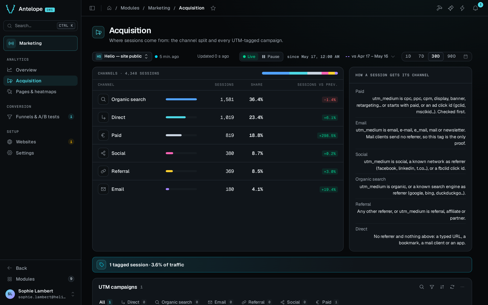

The Acquisition page is at `/modules/marketing/acquisition`, second under **Analytics**. The overview shows how much traffic came. This page shows where it came from: the split of sessions across six channels, the UTM campaign table, and the referrers and UTM details behind them. It reads the website and period of the [context bar](/docs/modules/marketing/usage/overview#the-context-bar).

## What the page shows

The page has these blocks, top to bottom:

- **No event yet.** While the website has not received its first event, a banner over the page says so and links to its install guide.
- **Channels.** Sessions grouped as **Direct**, **Organic search**, **Social**, **Email**, **Referral** and **Paid**, each with its share and its change against the comparison window. With **No comparison**, the change column is left out. Every channel is listed, even at zero. The tracker does not send the channel. The module derives it from the session's referrer domain, `utm_medium` and ad click id when it counts the session, see [How channels are classified](#how-channels-are-classified). A channel's row opens that channel's tab of the campaigns table, through `?campaigns.tab=<channel>`, a link you can share.
- **How a session gets its channel.** Beside the channels card, a card states the rules in order.
- **Tagged sessions.** A banner above the table gives the number of tagged sessions and their share of all traffic.
- **Missing medium.** When some sessions were tagged without `utm_medium`, a banner counts them. Without a medium, a session is classified by its referrer alone. It reads as Direct when the link carried no referrer, and a mail client never sends one. Add `utm_medium` to the link to fix the sessions that follow. The table flags each such row **No medium**.
- **UTM campaigns.** One row per source, medium and campaign triple seen on new sessions, and per channel those sessions were counted under. The referrer and the click id take part in that channel, so a row agrees with the channels card. A triple whose sessions landed in two channels takes two rows, for example `utm_source=facebook` from the app (Direct) and from facebook.com (Social). Rows are ranked by sessions, with their share of the period's sessions and a sessions-per-day sparkline. *not set* means the landing URL did not carry that parameter, so `?utm_source=newsletter` alone is a real campaign row. UTM values are trimmed, and source and medium are lower-cased, so `Email` and `email ` are one medium. The table searches, filters by channel, sorts and pages every row of the period, 25 rows per page. Its tabs, their counters and the footer count cover all rows.
- **Top referrers, UTM contents and UTM terms.** Three lists of the top five over the period. **Top referrers** lists the external referrer domains counted on new sessions, across all channels and not only Referral. Link-shim and mobile hosts such as `l.facebook.com` or `m.youtube.com` count as their network. **UTM contents** and **UTM terms** list `utm_content` and `utm_term`, the two parameters outside the triple.

Sessions that carry no UTM parameter appear in the channels card, as Direct, Organic search, Social or Referral, but never in the campaigns table.

## How channels are classified

The rules apply in order, and the first match wins. Matching on a referrer compares the labels of its domain, so `out.reddit.com` and `google.co.uk` match without a list of every mirror. The lists below are partial.

| Channel | Matches |
|---|---|
| Paid | `utm_medium` is `cpc`, `ppc`, `cpm`, `cpv`, `cpa`, `cpp`, `sem`, `display`, `banner` or `retargeting`, or starts with `paid` (`paid-social`, `paid_search`). Or the landing URL carries an ad click id: `gclid`, `gbraid`, `wbraid`, `dclid`, `msclkid`, `ttclid`, `twclid` or `li_fat_id`. |
| Email | `utm_medium` is `email`, `e-mail`, `e_mail`, `newsletter` or `mail`. |
| Social | `utm_medium` names social (`social`, `social-media`, `sm`), the referrer is a known social network (facebook, instagram, twitter, linkedin, reddit, tiktok, youtube, and shorteners such as `t.co` and `x.com`), or the landing URL carries `fbclid` or `igshid`. |
| Organic search | `utm_medium` is `organic`, or the referrer is a known search engine (google, bing, duckduckgo, yahoo, baidu, yandex). Hosts such as `mail.google.com` and `docs.google.com` are not search engines. |
| Referral | Any other external referrer, or `utm_medium` is `referral`, `affiliate` or `partner`, with or without a referrer. |
| Direct | No referrer and no rule above matched. |

Paid comes first because an ad click keeps its `google.com` or `facebook.com` referrer and would otherwise read as Organic search or Social. Email comes next, on its medium alone. A desktop mail client sends no referrer and a webmail sends its own host, so without the tag the session would read as Direct or Referral. A session with a medium the rules do not know is classified by its referrer, as Referral with one and Direct without.

The rules run when the session's rollup is written. The channel is stored only in the campaign key of the rollup, so a change to the rules needs no migration. It never reclassifies the past either. Sessions already rolled up keep their channel, and only sessions counted after the change follow the new rules. The Email channel and the referral mediums arrived that way. Days rolled up before them count those sessions as Direct or Referral.

## Where the numbers come from

Acquisition reads the daily rollups, never raw events, like the overview. The caveats of [Where the numbers come from](/docs/modules/marketing/usage/overview#where-the-numbers-come-from) apply, and these in particular:

- A day keeps at most `MAX_ENTRIES_PER_TOP_MAP` (50) campaign keys, each made of the source, medium, campaign and channel. Long-tail campaigns on days with many campaigns are approximate. Campaign keys rolled up before the channel joined them are left out of the table.
- Top lists are kept for `TOP_MAPS_RETENTION_DAYS`, a year plus 90 days. That is long enough to compare a 90-day window with the previous year. A comparison that reaches days whose lists were emptied shows no change, and the channels card says *No comparison: the details of days this old are no longer kept*.
- **Dimensions start at their ship date.** Days rolled up before the campaign and channel dimensions existed contribute nothing to this page. A window that overlaps that boundary undercounts campaigns. Traffic is not affected.
