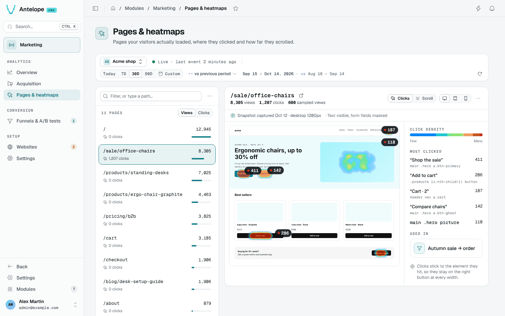
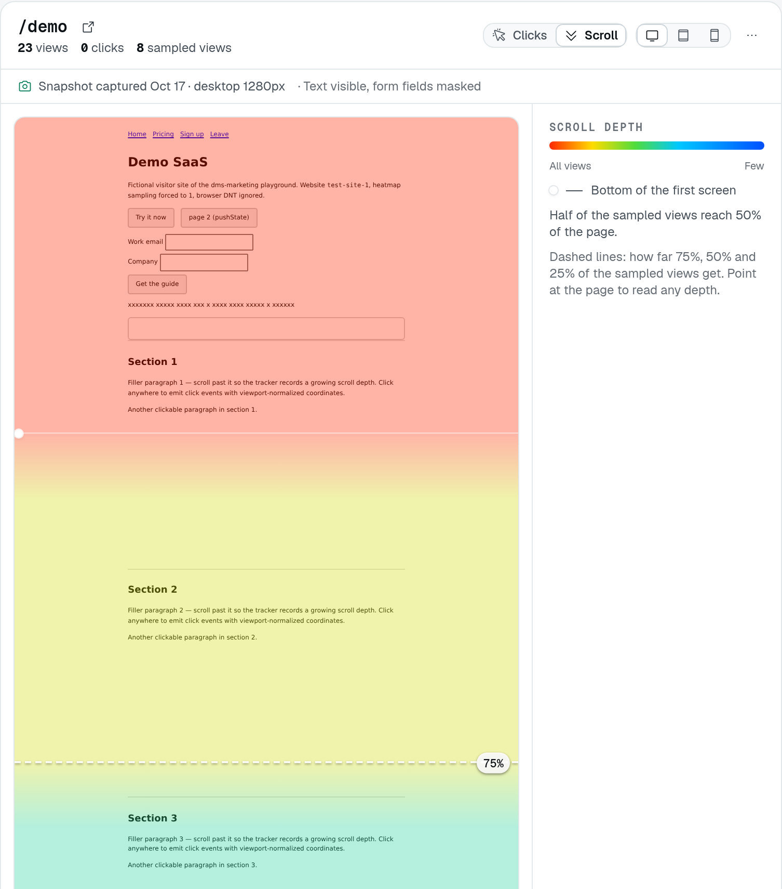

# Pages & heatmaps

**Where:** `/modules/marketing/pages` — under **Analytics**.

The page has two panes under the [context bar](/docs/modules/marketing/usage/overview#the-context-bar):
on the left, the inventory of paths the tracker has reported for the
selected website; on the right, the clicks and scroll depth of the selected
path, drawn over a snapshot of the page. The preview's toolbar switches the
overlay between **Clicks** and **Scroll depth** above the same backdrop, and
the layout between desktop, tablet and phone widths.

On a wide screen (1280 px and up) both panes fill the window below the
context bar, whatever the page shown: the list scrolls in its own column,
the snapshot scrolls inside the preview (the whole page, app shells
unrolled), and the toolbar, the legend and **Most clicked** stay in sight —
the page itself does not scroll. A page shorter than the pane ends on an
**End of page** line, the rest of the pane hatched, so nothing below it
reads as part of the page. A layout narrower than the pane stays centred
at its own width, never enlarged. Narrower screens stack the list above the
preview, which then grows with the snapshot.

The surface is keyed on nothing but a website id and a bare pathname the
tracker itself reported — no route registry, no sitemap, no build manifest, no
framework convention — which is what makes it hold for a tracked site built
any way at all.

## Reading a heatmap

1. Pick a **website** and a **period** in the context bar, then a **path**
   in the inventory. Each row gives the page's views, an estimate of the
   sampled visits behind its heatmap (views × sampling rate) and a heat bar
   relative to the busiest page. While the site has page snapshots on, a
   row also says how old the page's newest snapshot is ("3 hr ago", the
   layouts captured in its tooltip), **No snapshot** in muted text when
   none was taken yet, or **Too heavy** when the page cannot be captured;
   a site with snapshots off shows none of it — the preview says why.
2. The right pane renders the page's snapshot (see *Page snapshots* below)
   and draws the recorded clicks over it, sized to the page's own height.
   The hottest anchored elements carry a pin with their click count.
3. Beside the preview, **Most clicked** lists the five anchored elements
   with the most clicks, by their text, and **Used in** lists the funnels
   that have a page step on this path.

The selected path lives in the URL (`?path=`), so a heatmap can be linked
to; the overview's content lists link here that way.

### Clicks stick to elements, not to screen positions

Each click stores *which element it hit and where inside it* (a short CSS
selector plus a 0–1 offset in the element's box), on top of plain document
coordinates. The overlay projects from the element anchor whenever it can
resolve it in the snapshot. The practical effect: clicks recorded through
desktop windows still land on the right button when you view the page at
phone width, even though the layout moved everything around. The **Most
clicked** list and the pins are built from these anchored cells only; while
a page has none, the list says so and the clicks show on the page only.

Every way anchoring can fail (no snapshot yet, element gone, selector now
ambiguous) falls back to document fractions — which is also all that clicks
captured before anchoring ever had, so those render approximately. The
mechanism is detailed in [Architecture](/docs/modules/marketing/architecture#heatmap-anchoring).

## Scroll depth

The **Scroll depth** overlay shades the page by how many of the measured views saw
each band — warm at the top, cold where almost nobody went — with labelled
lines at fixed shares (*"50% of visitors see down to here"*) and a readout
following the pointer.

*Local demonstration, cropped to the upper part of the page. The colours show
the share of measured views that reached each depth. The **75%** line means
three quarters of those views reached that depth — not that they read 75% of
the page. Depth runs from 0 at the bottom of the first screen (the solid line)
to 100 at the page bottom, relative to each visitor's scrollable range.*

Three things to keep in mind when reading it:

- **Shares are "of the measured views".** The tracker records the max
  depth reached per sampled page load, scrolled or not: a view that never
  scrolls reports 0 (100 on a page that fits the screen). Views recorded
  before the tracker did so only counted when they scrolled.
- **Depth is a fraction of the visitor's scrollable range**, measured through
  windows this dashboard cannot know. The overlay anchors depth 0 at the
  bottom of the first screen (the viewport the snapshot was captured in) and
  100 at the bottom of the page: read bands and lines, not pixels.
- **Same sampling, same window as clicks** — one draw per page load decides
  both, and both read the raw events retention.

Resetting a heatmap deletes clicks, scroll depths and snapshots together
(see [Resetting heatmaps](#resetting-heatmaps)).

## Page snapshots

The backdrop is not the live site in a frame: it is a **snapshot** of the
page, captured in a visitor's browser by the tracker and replayed here.
Framing the live site was abandoned because most production sites refuse
it — `X-Frame-Options` or a CSP `frame-ancestors`, which Nginx, Cloudflare,
Helmet and framework templates set by default — and a refused frame gives
the console no signal at all: a blank panel and a guess.

How a snapshot comes to exist:

1. **Opt-in, per website.** Snapshots store page content, which nothing else
   in the module does. They are off until the site enables them. The switch
   lives in the website's settings on the Websites page (**General** tab,
   under **Collect data**, with what enabling it stores), and each card
   shows the state. The preview always says where it stands and links
   there (**Snapshot settings**): while snapshots are off its status strip
   carries **Enable page snapshots**, once on its status line reads
   captured / masked; the preview's **More** menu keeps both options (page
   snapshots on/off, mask all text) as a shortcut. Over the API the fields
   are `snapshotsEnabled` and `snapshotMaskText` on the website
   (`PUT /api/marketing/websites/:id`).
2. **Negotiated capture.** On a visit already sampled for clicks (the same
   draw, 10 % by default), once the page has loaded and gone idle, the
   tracker asks the backend whether a capture of this path at this layout
   is wanted. It is when none exists or the existing one is older than a
   day; the answer is then the capture script itself, otherwise nothing. So
   the first sampled visit of a page captures it, a page is captured about
   once a day however busy it is, and no visit uploads a capture that would
   be discarded. A page whose snapshot went — reset, an option change, the
   retention — is captured again at its next sampled visit, within minutes
   on a deployment of several instances; an upload the backend refused does
   not count as a capture. A capture taken before captures marked the
   scroll root of an app-shell page (see *Pages that scroll an inner
   container* below) is replaced at the next sampled visit too.
3. **Serialization in the visitor's browser.** The rendered DOM — what the
   visitor sees, whatever built it, client-rendered SPAs included — is
   serialized into one self-contained HTML document: same-origin stylesheets
   inlined from the CSSOM (CSS-in-JS included), URLs made absolute,
   cross-origin stylesheets left as links, open shadow roots emitted as
   declarative shadow DOM. Only the CSS the page uses is inlined: a style
   rule is kept when its selector matches an element of the captured page,
   tested as if hovered, focused or open and with its pseudo-element taken
   off (so `:hover`, `::before` and the like keep their style), and kept
   whenever the browser cannot test it; custom properties nothing refers to
   are dropped; `@media`, `@supports`, `@container` and `@layer` stay around
   what they still hold, for every layout; `@font-face`, `@keyframes` and
   `@property` stay; a stylesheet identical to one already inlined is not
   repeated. The upload is gzipped where the browser has `CompressionStream`
   (every current one), plain JSON otherwise. Captured after the DOM has
   gone quiet and in idle time, so the visitor's page never waits for it.
4. **Replay.** The console renders the document in a sandboxed frame: no
   script runs in it, nothing in it can be clicked, hovered or navigated —
   a stray click would take the backdrop to a page the numbers are not
   about — and its geometry is read directly to place anchored clicks.
   Interacting with the real page goes through **Open** in the preview's
   More menu, which opens a new tab on the origin the snapshot was captured
   on.

A page the tracker cannot capture — one not online yet, or one whose clicks
came from imported history — has counts but no backdrop. A project can
declare its snapshot from code with `EnsurePageSnapshot`
([Extending](/docs/modules/marketing/extending)): the document is sanitized
like a capture and shown the same way, and the first capture of the live
page, a day or more later, replaces it.

One snapshot is kept per (website, path, layout), the layout being the
visitor's viewport width bucketed as desktop (≥ 1024 px), tablet (≥ 600 px)
or phone. Asking for a layout nobody has been captured at reflows the
nearest one at that width, and the status strip says so; anchored clicks
still land on their element.

**The numbers never degrade, and nothing is drawn without a page.** Points
and totals come from the database; the snapshot is the surface they are
drawn on. Snapshots off for the site, no sampled visit captured yet, a page
too heavy to capture — the click and scroll counts stay in the header, the
status strip says why there is no backdrop and when there will be one, and
no empty pane pretends to be a page. Otherwise a status line under the
toolbar gives when and at which layout the snapshot was captured, the page
it was taken from (origin and path, e.g. `from https://shop.example/pricing`
— never a query string, see below), and what it masks.

### The status strip

When something needs attention, the preview shows **one** strip under its
toolbar, the highest-priority one, with its own action where there is one:

1. **Collection is off** — the tracker is switched off in the settings;
   links to them.
2. **Page snapshots are off for this site** — with **Enable page
   snapshots**.
3. **No snapshot of this path yet** — the next sampled visit captures one.
4. **Page too heavy to capture** — see *Retention and size* below.
5. **N % of clicks aim at elements missing from this snapshot** (clicks
   overlay) — the page has probably changed since it was captured. Counted
   by weight over the clicks that carry an element anchor: those whose
   selector and rank match no element of the snapshot document, which the
   overlay draws at their document fraction instead. Shown from 10 % of the
   anchored clicks and at least 5 clicks; an element that is in the
   snapshot but not drawn at the chosen width (a phone-only menu on the
   desktop layout) does not count. The strip stays on one line, so the
   snapshot keeps its room: the explanation sits behind its info button,
   and its action is **Reset this page…**, which clears the page's clicks
   and snapshot so both start again from the current version. Closing it
   hides it for that page until the console is reloaded; the next strip
   that applies, if any, takes its place.
6. **Partial heatmap / partial scroll depth** — the page recorded more
   clicks or scrolls than one read covers; narrow the period.
7. **Page too tall to preview accurately** — the document exceeds the
   largest surface the browser draws, so the overlay and the backdrop no
   longer line up; the figures are unaffected.
8. **Approximate layout** — no visitor has been captured at the chosen
   width, so the nearest snapshot is reflowed.
9. **Page wider than the chosen layout** — the backdrop may be cut off;
   the overlay follows the document and stays aligned.

### What is and is not captured

Unconditionally, whatever the options:

- **Form values never leave the page.** Input and textarea values, checked
  and selected states are dropped; hidden inputs are dropped whole;
  `contenteditable` text is masked.
- **Nothing executable.** Scripts, event handler attributes, `javascript:`
  URLs, `<noscript>` content, frames, objects and embeds are dropped.
- **Links keep their target without query string or fragment** — tokens and
  addresses ride there, and nothing in the backdrop is clickable anyway.
- **The page's own URL is kept as origin and path only**, for the same
  reason: a snapshot of `/pricing?coupon=…#signup` is stored, and shown in
  the preview's status line, as `https://shop.example/pricing`. Every visit
  of the path, whatever its query, shares that one snapshot per layout.
- Canvases are frozen as images (when not tainted), videos keep their
  poster, images keep the source the visitor's browser actually chose.

Markers the integrator can put on any element of the site:

- `data-dms-marketing-mask` (or the class `dms-marketing-mask`) masks every
  character of the text inside, keeping whitespace so the layout holds.
- `data-dms-marketing-block` (or the class `dms-marketing-block`) replaces
  the element with an empty box of the same size, id and class kept so the
  page's CSS still lays it out and clicks anchored to it still resolve.

**Transient overlays are left out on their own.** What the visit had open
over the page at capture time belongs to that visit, not to the page, so
the capture drops:

- anything in the browser's top layer — a modal `<dialog>`, an open
  `popover`;
- an element with role `dialog`, `alertdialog`, `tooltip`, `menu` or
  `listbox` that is positioned `fixed` or `absolute`, or mounted in a fixed
  portal directly under `body` (where floating menus and popovers live) —
  a "star us" prompt in a corner, an open dropdown;
- a live region (role `status`, `alert` or `log`, or `aria-live`) fixed to
  the viewport — a toast, a notification;
- a toast viewport: a region or live element whose list child is fixed
  (Reka / Nuxt UI, Radix, Sonner).

In-flow content stays whatever its role: an inline `role="status"` badge, a
listbox in a form, a menu inside the app's own fixed header. An overlay the
rule does not recognize is still yours to leave out with
`data-dms-marketing-block`.

The per-site option **Mask all text** masks every text node of the capture;
images stay, so block the personal ones. Changing either option discards
the site's existing snapshots; the next sampled visits recapture under the
new rules. Wherever the options are offered (the **Page snapshots** and
**Mask all text** checkboxes of this page's More menu, the Websites page's
drawer), every change is asked first: with how many snapshots will go when
the site has some — clicks and scroll depth stay — and as a change of
setting when it has none yet. Declining saves nothing and leaves the
checkbox as it was. Turning snapshots on for a site holding none is the one
change saved without a question.

### Retention and size

Snapshots live under their own retention — **page snapshot retention** in
[Settings](/docs/modules/marketing/usage/settings), 30 days by default, never longer than the raw
events — and are replaced daily while the page keeps being visited. They
die with a heatmap reset (the page changed), with the site, and with the
tenant. A site keeps at most 1000 of them; a page past that cap gets no
backdrop.

**A capture is at most 1 MiB to upload** by default, compressed — the
`snapshotMaxBytes` option ([Configuration](/docs/modules/marketing/configuration))
moves the cap between 64 KiB and 8 MiB. What counts is the HTML and the CSS
the page uses, never the images, videos or fonts, which stay URLs the
console reloads from your site. When a capture comes out past the cap, the
browser uploads its size instead of the document. The page then has no
backdrop and says so — *"Page too heavy to capture: the last sampled visit's
capture came to 1.4 MiB to upload, past the 1 MiB cap"* — with the click and
scroll figures untouched, and a capture is retried daily. Ways under the
cap: trim the markup (a table of thousands of rows), wrap the heavy part in
`data-dms-marketing-block`, which keeps its box and drops its content, or
raise `snapshotMaxBytes`.

What overshoots the cap is a page's *markup*, so it is rare: unused CSS is
left out and the upload compressed, so even a dashboard page in development
(Tailwind, a component library and every module layer loaded, about 870 KB
of CSS) uploads in about 50 KB.

### Limits worth knowing

- **Viewport-relative sizes.** The frame is as tall as the whole page, so
  inside it `100vh` would be the page, not a screen. The console rewrites
  `vh`, `svh`, `lvh`, `dvh`, `vmin` and `vmax` in the captured stylesheets
  to the pixels they had in the visitor's viewport before rendering; only
  a stylesheet the capture could not inline (cross-origin) keeps them, and
  a media query on the viewport *height* still sees the frame's.
- **Pages that scroll an inner panel.** An app shell (a dashboard, a
  sidebar layout) often keeps its document still and scrolls a container
  inside it. The tracker measures scroll depth and click positions on that
  container, and the capture marks it, so the backdrop is unrolled to the
  whole content and scrolls to the bottom of the page. Which container
  counts, and how to name it yourself, is in
  [Tracker & custom events](/docs/modules/marketing/usage/tracking#pages-that-scroll-an-inner-container).
  Snapshots taken before carry no mark and still show the first screen
  only; the next sampled visit of a page the tracker sees scrolling an inner
  container replaces them, without waiting for the daily refresh.
- **Late content.** Data fetched long after load, infinite scroll, sections
  lazily rendered below the fold: whatever had not landed when the DOM went
  quiet is missing or in its loading state.
- **Fonts and cross-origin styles.** A stylesheet the browser refuses to
  read (cross-origin) stays a link fetched by the admin's browser; a font
  served without CORS headers falls back to the default one.
- **The console's own CSP.** The frame inherits it: a deployment restricting
  `img-src` or `style-src` on the console loses the backdrop's images or
  styles, never its structure.

## When the heatmap is empty

Clicks are **sampled**: by default only 10 % of page loads record clicks and
scrolls (configurable — see [Settings](/docs/modules/marketing/usage/settings), or per site with
`data-heatmap-sample` on the embed). A quiet page over a short period can
legitimately have nothing to show; the empty state says so and suggests the
two levers that actually produced the silence — sampling rate and period.

Heatmaps also read the **raw events window**: clicks older than the raw
events retention (90 days by default) are gone even if the context bar
allows the range.

## Resetting heatmaps

When pages are redesigned, old clicks land on elements that no longer
exist. Two resets, both irreversible and both behind a confirmation that
asks you to type a name:

- **Reset every heatmap…**, in the **More** menu beside the list's filter, deletes
  every click, scroll depth and snapshot of the website, whatever the
  period. Type the website's domain to confirm.
- **Reset this page…**, in the preview's **More** menu, deletes the clicks,
  scroll depths and snapshots of the selected path, whatever the period. Type
  the path to confirm; the confirm button gives the number of events the
  preview counts over the selected period.

Both say what they keep: traffic, sessions and funnels are not affected, and
the toast after the reset gives the number of events deleted.

## Reading another workspace's dashboard

With [dashboard tracking](/docs/modules/marketing/configuration#tracking-the-dashboard-itself)
on, every workspace has its own dashboard website, and its data stays in that
workspace. A **platform owner** looking at their own dashboard website gets
one more control at the top of the pages list, above its search,
**Workspace: … ▾**, to read the dashboard's heatmaps somewhere else (the
website picker stays in the page toolbar):

- **Your workspace** — the default: exactly the view everyone else has.
- **Another workspace** — that workspace's dashboard website, the same
  page paths, its clicks, scroll depth and pages list.
- **All workspaces** — every workspace's dashboard website combined for
  the same path: clicks are added up per element (the selector and its
  rank, then the offset inside it) or per document cell, scroll depths and
  page counts add up, and **Most clicked**, the drift share and the
  sampling note read the combined figures. Each workspace is counted in
  its own tenant, within its own retention, then merged.

The choice is in the URL (`?workspace=all`, or a workspace's id), so a link
opens on it, and this browser remembers the last one for the next visit.
The workspaces are read with the page, so the control is in place from the
first paint and the list never moves down under you.

Outside your own workspace the view is **read-only** — no reset, no
snapshot option; the info icon beside the selector says so in its tooltip,
which screen readers also announce with the selector — and the backdrop is **always text-masked**, whatever the
source website's own mask setting: structure, blocks, images and styles
stay, every word becomes `x`. The masking is done by the server before the
snapshot is sent, so another workspace's records never reach the browser.
In combined mode the backdrop is the most recent capture among the
workspaces for that path and layout, masked the same way.

Who sees the control:

- **Only platform owners.** A workspace owner — a customer of a SaaS
  install — never sees it, and the server refuses the parameter for them
  (`404`, as for an unknown website), not just the interface.
- **Only on the dashboard's own website.** Customer websites stay per
  workspace.
- **Only with two workspaces or more** that have a dashboard website. A
  single-workspace install, with or without dms-saas, shows nothing new.
  The workspaces and their names come from the DMS core's workspace
  registry, not from dms-saas.

## Paths: two ways they can collapse

Both worth knowing before reading a heatmap:

- **Hash-routed SPAs** report one path for the whole site — the tracker sends
  origin + pathname + search, never `location.hash`.
- **Pages keyed by query string** collapse likewise: the query is sent, then
  dropped at ingestion. WordPress with default `?p=123` permalinks stores as `/`.

## A missing path is not a path without clicks

The inventory is built from the daily rollups, which keep at most 50 paths
per day (and older days keep scalar counters only) — so the inventory is
lossy while the heatmap query is not. That is why the filter is also a path
field: type a path starting with `/` and press Enter, and it is inspected
exactly like a picked one. If you know a path had traffic, type it.
