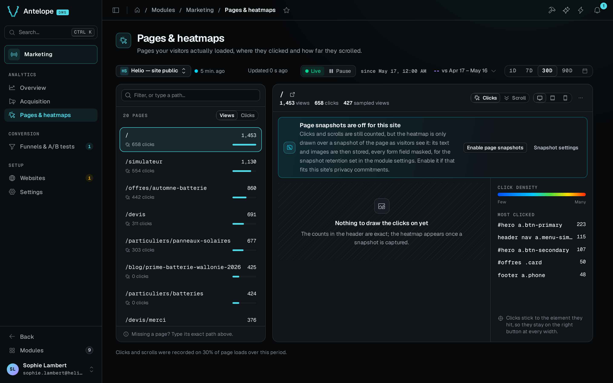
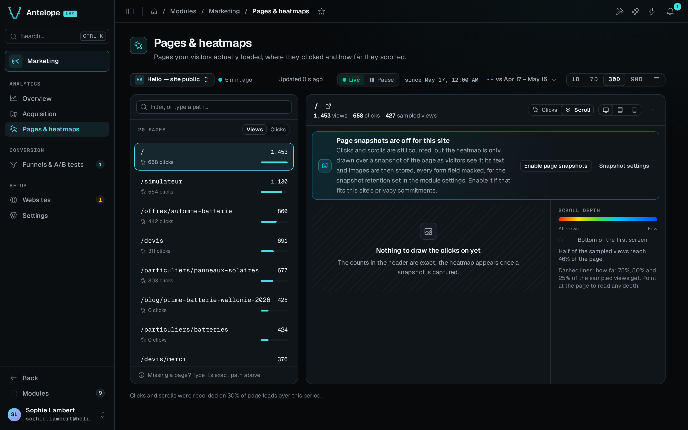

The Pages & heatmaps page is at `/modules/marketing/pages`, third under **Analytics**. It has two panes under the [context bar](/docs/modules/marketing/usage/overview#the-context-bar). The left pane lists the paths the tracker has reported for the selected website. The right pane draws the clicks or the scroll depth of the selected path over a [snapshot](/docs/modules/marketing/usage/page-snapshots) of the page. The preview's toolbar switches the overlay between **Clicks** and **Scroll** over the same backdrop. It also switches the layout between **Desktop** (1280 px), **Tablet (portrait)** (768 px) and **Phone** (390 px).

On a screen 1280 px wide or more, both panes fill the window below the context bar, and the page itself does not scroll. The list scrolls in its own column. The snapshot scrolls inside the preview, the whole page with app shells unrolled. The toolbar, the legend and **Most clicked** stay in sight. A page shorter than the pane ends on an **End of page** line, with the rest of the pane hatched, so nothing below it reads as part of the page. A layout narrower than the pane stays centred at its own width and is never enlarged. A narrower screen stacks the list above the preview, which then grows with the snapshot.

The page needs nothing but a website id and a bare pathname the tracker reported. It reads no route registry, sitemap, build manifest or framework convention, so it works for a tracked site built any way.

While the selected website has not received its first event, the page shows the way to its install guide instead of the panes.

## Reading a heatmap

The page list and the preview work together:

- **The page list.** Each row gives the page's views and clicks, with a heat bar relative to the busiest page. **Sort by** orders the rows by views or by clicks. While the site has page snapshots on, a row also gives the age of the page's newest snapshot, such as *3 hr ago*, with the captured layouts in its tooltip. It reads **No snapshot** when none was taken yet, or **Too heavy** when the page cannot be captured. A site with snapshots off shows none of these badges, and the preview says why.
- **The preview.** It renders the page's snapshot and draws the recorded clicks over it, sized to the page's own height. The hottest anchored elements carry a pin with their click count. The header gives the page's views and clicks, and an icon beside the path opens the live page in a new tab.
- **Beside the preview.** **Most clicked** lists the five anchored elements with the most clicks, by their text. **Used in** lists the funnels that have a page step on this path.

The selected path is in the URL (`?path=`), so you can link to a heatmap. The content lists of the overview link here that way.

### Clicks stick to elements, not to screen positions

Each click stores the element it hit as a short CSS selector, and its position inside that element as a 0 to 1 offset in the element's box. It also stores plain document coordinates. The overlay projects a click from its element whenever it finds that element in the snapshot. A click recorded through a desktop window still lands on the right button when you view the page at phone width, even though the layout moved everything. **Most clicked** and the pins use these anchored clicks only. While a page has none, the list says *No element anchored yet: clicks show on the page only*.

When anchoring fails, the overlay falls back to document fractions. Anchoring fails when there is no snapshot yet, when the element is gone, or when the selector now matches another element. Clicks captured before anchoring existed carry document fractions only, so they render approximately. [Architecture](/docs/modules/marketing/architecture/snapshots-and-heatmaps#heatmap-anchoring) describes the mechanism.

## Scroll depth

The **Scroll** overlay shades the page by the share of measured views that saw each band. Bands are warm at the top and cold where almost nobody went. Dashed lines mark how far 75%, 50% and 25% of the sampled views get (*50% of sampled views reach here*), and a readout follows the pointer.

The screenshot is a local demonstration, cropped to the upper part of the page. The **75%** line means that three quarters of the measured views reached that depth. It does not mean that they read 75% of the page. Depth runs from 0 at the bottom of the first screen (the solid line) to 100 at the bottom of the page, relative to each visitor's scrollable range.

Three facts govern how the overlay reads:

- **Shares are of the measured views.** The tracker records the deepest point each sampled page load reached, whether it scrolled or not. A view that never scrolls reports 0, or 100 on a page that fits the screen. Views recorded before the tracker did so counted only when they scrolled.
- **Depth is a fraction of the visitor's scrollable range**, measured through windows the dashboard cannot know. The overlay puts depth 0 at the bottom of the first screen, in the viewport the snapshot was captured in, and 100 at the bottom of the page. Read the bands and lines, not the pixels.
- **Clicks and scroll depth share their sampling and their window.** One draw per page load decides both, and both read within the raw events retention.

Resetting a heatmap deletes clicks, scroll depths and snapshots together, see [Resetting heatmaps](#resetting-heatmaps).

## Page snapshots

The backdrop is a snapshot of the page that the tracker captured in a visitor's browser, not the live site in a frame. Snapshots are off until you enable them per website, because they store page content. [Page snapshots](/docs/modules/marketing/usage/page-snapshots) covers how a capture is made, the status strip of the preview, retention, the size cap and the limits of the replay.

## What is and is not captured

The capture applies these rules whatever the options:

- **Form values never leave the page.** Input and textarea values and checked and selected states are dropped. Hidden inputs are dropped whole. `contenteditable` text is masked.
- **Nothing executable is kept.** Scripts, event handler attributes, `javascript:` URLs, `<noscript>` content, frames, objects and embeds are dropped.
- **Links keep their target without query string or fragment.** Tokens and addresses travel there, and nothing in the backdrop is clickable anyway.
- **The page's own URL is kept as origin and path only**, for the same reason. A snapshot of `/pricing?coupon=…#signup` is stored, and shown in the preview's status line, as `https://shop.example/pricing`. Every visit of the path, whatever its query, shares that one snapshot per layout.
- **Media is frozen.** A canvas becomes an image when it is not tainted, a video keeps its poster, and an image keeps the source the visitor's browser chose.

You can put these markers on any element of the site:

- `data-dms-marketing-mask`, or the class `dms-marketing-mask`, masks every character of the text inside and keeps the whitespace, so the layout holds.
- `data-dms-marketing-block`, or the class `dms-marketing-block`, replaces the element with an empty box of the same size. The box keeps the element's id and class, so the page's CSS still lays it out and clicks anchored to it still resolve.

The capture leaves out transient overlays on its own. What the visit had open over the page belongs to that visit, not to the page. The capture drops:

- anything in the browser's top layer, such as a modal `<dialog>` or an open `popover`.
- an element with role `dialog`, `alertdialog`, `tooltip`, `menu` or `listbox` that is positioned `fixed` or `absolute`, or mounted in a fixed portal directly under `body`, where floating menus and popovers live. A "star us" prompt in a corner and an open dropdown are examples.
- a live region fixed to the viewport, with role `status`, `alert` or `log`, or with `aria-live`. A toast and a notification are examples.
- a toast viewport, meaning a region or live element whose list child is fixed, as in Reka UI, Nuxt UI, Radix and Sonner.

In-flow content stays whatever its role, such as an inline `role="status"` badge, a listbox in a form, a menu inside the app's own fixed header. To leave out an overlay the rule does not recognize, mark it with `data-dms-marketing-block`.

The per-site option **Mask all text** masks every text node of the capture. Images stay, so block the personal ones. Changing **Page snapshots** or **Mask all text** discards the site's existing snapshots, and the next sampled visits capture again under the new rules. Both options are in the preview's **More** menu and in the website's settings on the Websites page. Each change asks first. When the site holds snapshots, the question gives how many will go, and says that clicks and scroll depth stay. Declining saves nothing and leaves the checkbox as it was. Turning snapshots on for a site that holds none is the one change saved without a question.

## When the heatmap is empty

Clicks and scrolls are sampled. By default, 10% of page loads record them. You change the rate in [Settings](/docs/modules/marketing/usage/settings), or per site with `data-heatmap-sample` on the embed. A quiet page over a short period can have nothing to show. The empty state says so and names the two settings that decide it, the sampling rate and the period.

Heatmaps also read within the raw events window. Clicks older than the raw events retention, 90 days by default, are gone even when the context bar allows the range.

## Resetting heatmaps

After a redesign, old clicks land on elements that no longer exist. **Reset this page…**, in the preview's **More** menu and on the drift strip, deletes the clicks, scroll depths and snapshots of the selected path, whatever the period. Type the path to confirm. The confirm button gives the number of events and snapshots it deletes, and so does the toast afterwards. The page then shows 0 clicks in the list, the preview and **Most clicked**, which all read the same click events. Traffic, sessions and funnels are not affected.

To purge the heatmaps of a whole website, open the website's settings on the Websites page, then **Danger zone**, then **Purge heatmaps…**, see [Websites](/docs/modules/marketing/usage/websites).

## Reading another workspace's dashboard

With [dashboard tracking](/docs/modules/marketing/configuration#tracking-the-dashboard-itself) on, every workspace has its own dashboard website, and its data stays in that workspace. A platform owner who looks at their own dashboard website gets one more control at the top of the pages list, above its search: **Workspace:** followed by the current choice. It reads the dashboard's heatmaps from another workspace. The website picker stays in the page toolbar. The control offers these choices:

- **Your workspace** is the default, the same view everyone else has.
- **Another workspace** shows that workspace's dashboard website, with the same page paths and its own clicks, scroll depth and pages list.
- **All workspaces** combines the dashboard websites of every workspace for the same path. Clicks add up per element (the selector and its rank, then the offset inside it) or per document cell. Scroll depths and page counts add up. **Most clicked**, the drift share and the sampling note read the combined figures. Each workspace is counted in its own tenant, within its own retention, then merged.

The choice is in the URL (`?workspace=all`, or a workspace's id), so a link opens on it. The browser remembers the last choice for the next visit. The workspaces load with the page, so the control is in place from the first paint and the list never moves down under you. Switching keeps the selected page. Its header shows that page's views in the new workspace, or none while the page has no row there, never the previous workspace's.

Outside your own workspace, the view is read-only. It has no reset and no snapshot option. The info icon beside the selector says so in its tooltip, which screen readers announce with the selector. The backdrop is always text-masked, whatever the source website's own mask setting. Structure, blocks, images and styles stay, and every word becomes `x`. The server masks the snapshot before it sends it, so another workspace's records never reach the browser. In combined mode, the backdrop is the most recent capture among the workspaces for that path and layout, masked the same way.

The control shows only under these conditions:

- **The viewer is a platform owner.** A workspace owner, such as a customer of a SaaS install, never sees it. The server refuses the parameter for them with `404`, as for an unknown website.
- **The website is the dashboard's own.** Customer websites stay per workspace.
- **Two workspaces or more have a dashboard website.** A single-workspace install, with or without `dms-saas`, shows nothing new. The workspaces and their names come from the DMS core's workspace registry, not from `dms-saas`.

## Paths can collapse in two ways

Check how a site builds its URLs before you read its heatmap:

- **A hash-routed SPA reports one path for the whole site.** The tracker sends origin, pathname and search, never `location.hash`.
- **Pages keyed by query string collapse too.** The tracker sends the query, and ingestion drops it. WordPress with default `?p=123` permalinks stores every page as `/`.

## A missing path is not a path without clicks

The page list is built from the daily rollups. They keep at most 50 paths per day, and older days keep scalar counters only. The list is lossy, and the heatmap query is not. The filter is also a path field for that reason. Type a path that starts with `/` and press Enter, and the page inspects it like a picked one. If you know a path had traffic, type it.
