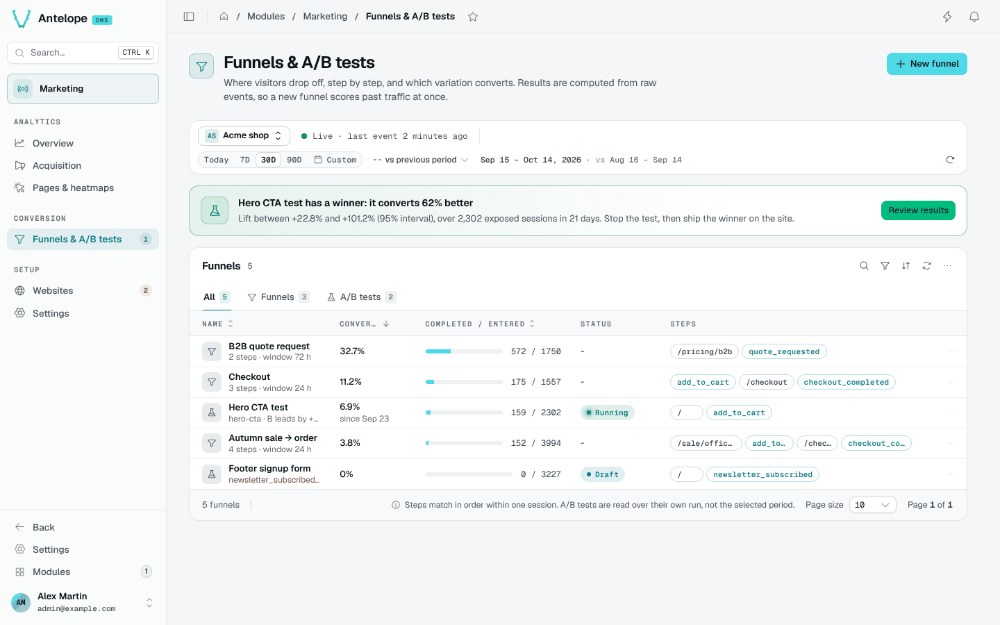
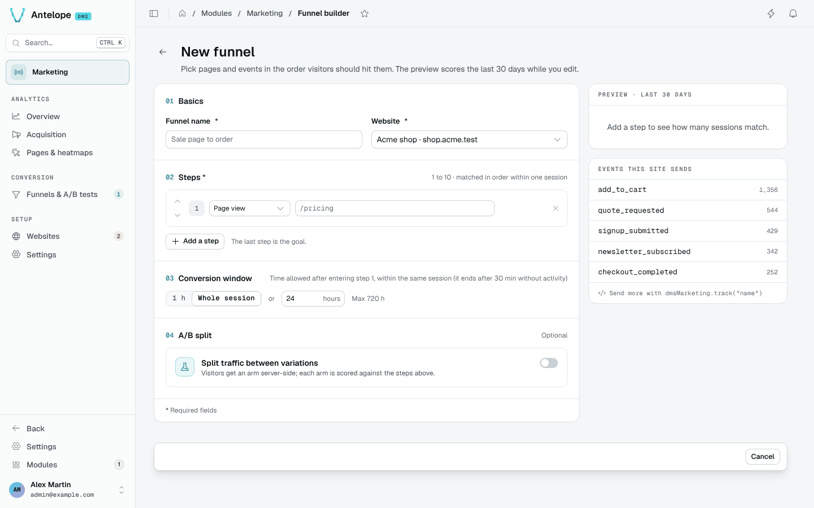
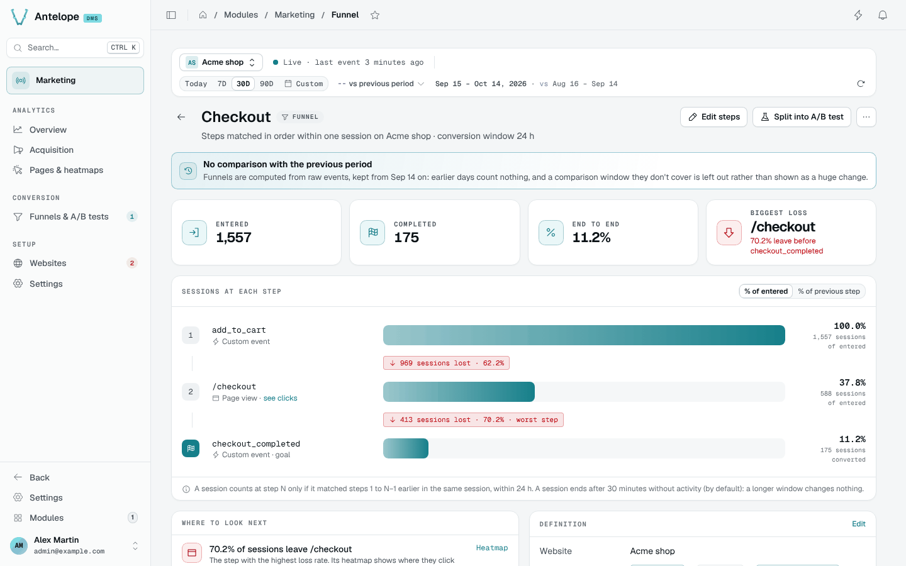
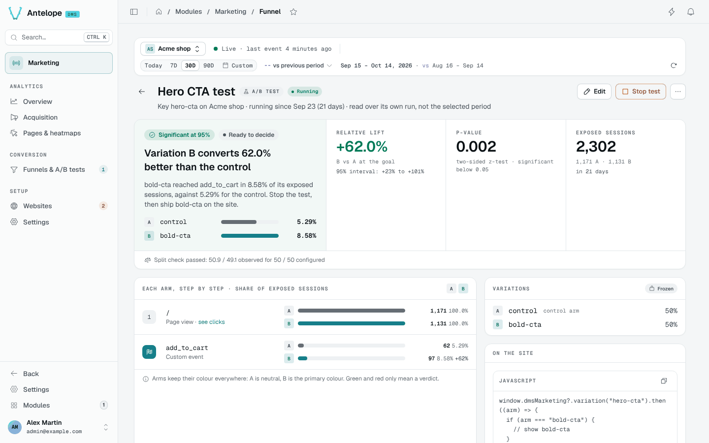

# Funnels & A/B tests

**Where:** `/modules/marketing/funnels` — under **Conversion**. Each funnel
opens on its report page (`/modules/marketing/funnel?id=<funnel id>`), and
the builder (`/modules/marketing/funnel-builder`) creates and edits them.

A funnel is an ordered conversion journey — "landed on `/pricing`, then
submitted the signup form" — measured over the sessions of a period. A
funnel can also be **split** into A/B variations: the backend then assigns
every visitor an arm, the page applies it, and the funnel is read once per
arm, under a significance verdict.



## The funnels list

One row per funnel of the website picked in the
[context bar](/docs/modules/marketing/usage/overview#the-context-bar): its end-to-end conversion with
its change against the comparison window (in points, plain funnels and draft
splits; *vs previous period* or *vs previous year*, none with *No
comparison*), the sessions that completed out of those that entered as a bar, its
status, and its steps as pills (pages outlined, events in the primary
colour). Under the name: the steps and window, the A/B split's state and
leader (by its own letter, only when it is ahead of the control), or a step
the site never sent over the period, in amber. A click on the row opens
the report; its menu edits, duplicates or deletes the funnel (the
name must be typed, and a running test is said to stop). The tabs narrow the
table to **Funnels** or **A/B tests**.

The banner above the table shows one thing: days of the period the raw
events do not cover (funnels then count nothing for them), else a running
test ready to decide (significant, its leader ahead, a full week served and
50 conversions in every arm), else a comparison window left out because the
raw events do not cover it — rather than a +1,000 % change. The sidebar badge
on the page counts the running A/B tests of the workspace.

A website without any funnel shows templates instead, built from its own
journeys over the period: its custom events triggered by the most sessions,
each led by the page those sessions viewed most often before it, with the
number of sessions that would enter it. One click opens the builder
prefilled with its steps (`?steps=`), or **Start from scratch** opens it empty.

## Defining a funnel

**New funnel** in the page header opens the builder; **Edit** on a report
opens it on that funnel (`?id=`). **Duplicate** in the builder's header opens
a new funnel prefilled with a copy of it (`?copy=<id>`): the name becomes
*Copy of …*, the steps, window and arms are kept, and the experiment key is
left empty — keys are unique per site, and a new hypothesis is a new key.
The copy is unsaved until **Save**: **Cancel** in the save bar drops it and
goes back to the funnel it was copied from, and leaving an untouched copy
asks nothing (only edits made to it are guarded).



- **Steps** — 1 to 10, each either a **page URL** (a path the visitor must
  view; a pasted URL, query string, fragment or trailing slash comes down to
  the path, the case is ignored, and a final `*` matches every path that
  starts with it, as in `/blog/*`) or a **custom event** (a name reported through
  `window.dmsMarketing.track(...)` — see [Tracker & custom events](/docs/modules/marketing/usage/tracking)). The
  fields autocomplete from the site's tracked pages and custom events, with
  their views or triggers. A single step is a conversion counter on its own;
  the last step is the goal.
- **Conversion window** — how long a session has to complete the journey
  after entering step 1: **1 h**, **24 h** or any number of
  hours. Default 24 h, maximum 720 h. A funnel is matched within **one
  session**, and a session ends after 30 minutes without activity (by
  default): a window longer than the session changes nothing, which is why
  the builder no longer offers 7 or 30 days. Journeys across visits would
  need a per-visitor read — the visitor hash is salted per month, so such a
  read would also break at each month boundary.
- **Website** — a funnel belongs to one website. A plain funnel or a draft
  split can move to another website; a started split stays on its own.
- **A/B split** — off by default; see [below](#splitting-a-funnel-into-ab-variations).

While you edit, the **preview** scores the definition over the last 30 days
(`POST /api/marketing/funnels/preview`, nothing saved): sessions at each step,
the share of the previous step that reached it, and end to end. Invalid steps
answer `400`, never a server error.

The builder follows the DMS form contract. **Unsaved changes** appear only
once a value differs from what the page opened on (putting it back clears
them); **Discard** restores it, and leaving with changes — Cancel, the back
arrow, the sidebar, the browser's Back, a reload — asks first. **Save** checks
the form before sending it and shows each problem under its field (name of
100 characters max, steps of 500, a window of 1–720 whole hours, keys and
weights below); what the server refuses lands under its field too. Changing
the steps or the window of a split that has started warns, then asks for a
confirmation on save: every arm is re-scored over the whole test with the new
goal.

Steps are matched **in order within a session**: a session counts for step N
only if it already matched steps 1…N-1, earlier in time.

## Reading a plain funnel



The breadcrumb ends with the funnel's name once the report has loaded.
The report page opens on four figures: sessions **entered**, sessions
**completed** and the **end-to-end** conversion, each with its change
against the comparison window (end to end in points), and the **biggest
loss** — the step with the highest loss rate. Below them, one bar per step
carries the sessions that reached it, read as **% of entered** or **% of
previous step** (a toggle), with the sessions lost before the next step; the
biggest loss is flagged **worst step**. **Where to look next** names that
step, with a link to its heatmap when it is a page, and the share of
sessions that never reach step 2, with a link that opens the builder to
split the funnel into an A/B test. **Definition** restates the steps, the
window and the website.

Results are computed at read time over the raw events of the selected period
(bounded at `MAX_FUNNEL_EVENTS` = 200 000 events per computation, past which
a **Window truncated** warning says the numbers cover the oldest part of the
period only), so a new funnel definition immediately shows results for past
traffic — no waiting for data to accumulate. The flip side: the period
cannot reach past the raw events retention (90 days by default).

## Splitting a funnel into A/B variations

Turn on **Split traffic between variations** in the builder (or **Split
into A/B test** on a report, which opens the builder with it on,
`?split=1`). The split is a **key** (the slug page code asks for:
lowercase letters, digits, `-` and `_`, starting with a letter or a digit,
64 characters max — variation keys follow the same rule) and 2–8
**variations** `{key, weight}` — weights are relative and normalized (0 or
more, at least one above 0), and
the builder shows each as its share of traffic; the **first variation is the
control**. The funnel's own steps are the goal every arm is scored against;
nothing else needs to exist anywhere. The builder also shows the
`variation()` snippet for the key, and a sample-size hint: how many entered
sessions detecting a +20% relative lift at the preview's conversion rate
would take (two-proportion test, 95% confidence, 80% power) — sized on the
arm with the smallest share of the traffic, so uneven weights take longer —
and how many months that is at the site's current traffic. The hint is hidden
once the split has started.

```
marketing_funnels ──► GET /api/marketing/experiments.js?website=<id>
   (split running)                  │  (public, per-visitor, no-store)
                                    ▼
                      await dmsMarketing.variation("hero-cta")
                                    │  page applies the arm
                                    ▼
                      `exposure` events through collect
                                    │
                                    ▼
                      A/B report: each arm step by step + z-test
```

The lifecycle is `draft → running ⇄ stopped`, driven by the **Start test**,
**Stop test** and **Resume test** buttons of the report page, each behind a
confirmation: Start lists what freezes (the key and the variations with
their shares) and reminds that the page must call `variation()`; Stop says
every visitor gets the control again. Nothing ever returns to
draft. Only `running` splits are served to visitors, and the key and
variations **freeze once the split leaves draft**: moving weights mid-run
would shift the deterministic buckets and silently reassign visitors. The
name, the steps and the window **stay editable at any status** — results are
computed read-time, so a step change re-scores past traffic immediately and
never touches assignment. The split itself can only be removed while it is a
draft; a stopped one keeps its results readable until the funnel is deleted,
which is allowed at any status — pages fall back to the control within the
definitions cache TTL (30 s).

**Stopping ends the measurement, not just the assignment.** From the stop
on, the endpoint serves no assignment for the key — every visitor falls back
to the control within the definitions TTL (30 s), pages already open at their
next reload — collect refuses exposures for it, and the results are read over
the runs that closed, so the numbers of a stopped split are final. The reverse holds at the other end: a draft
has no results at all, only the plain funnel underneath it. Sessions exposed
shortly before the stop keep the funnel's whole conversion window to reach
the goal, and those late conversions still count.

**Resuming picks up where the stop left off.** The arms and their weights are
frozen, so the same visitor lands on the same arm as before and the sessions
already exposed stay in the counts: the split simply gains a second run, and
the pause between the two counts for nothing — no assignment, no exposure.
Resume when the stop was accidental or too early. Do not resume
because the verdict was not the one you hoped for: stopping on a p-value and
gathering more until it moves is optional stopping, and it inflates the
false-positive rate well past the 95% the verdict claims. To test a changed
hypothesis — other arms, other weights — create a new split instead.

While the split is a draft, the report still reads as the plain funnel —
the baseline the arms will be compared to — under a *Saved as a draft*
notice.

### Client-site integration

One call, where the variation is applied:

```js
window.dmsMarketing?.variation("hero-cta").then((arm) => {
  if (arm === "b") {
    showAlternateHero();
  }
});
```

Promise-based, so it runs as is in a classic `<script>` (a top-level
`await` only works in a module script); the builder's snippet has this shape.

- **Assignment is server-side and deterministic** —
  `sha256(visitorId : experiment key)` against the normalized weights. The
  same visitor keeps the same arm for the whole month (the identity salt
  rotates monthly, see
  [Architecture](/docs/modules/marketing/architecture#anonymous-identity)); nothing is
  stored on the visitor's device.
- **`null` means render the control** — key unknown or not running,
  collection disabled, DNT. Treat every non-matching answer as
  the control and the page degrades safely.
- **The exposure is reported by the call itself**, once per page load, and
  only for the keys the page consulted: a split fetched but never asked for
  does not count anyone as exposed.
- **Browser-side only.** The assignment derives from the *visitor's own
  request* (IP + user agent). Fetching it at SSR time would put every
  visitor behind the renderer's single identity — one arm for everyone. If
  you must assign server-side, run your own split and report it with
  `dmsMarketing.exposure(experiment, variation)` — which the backend accepts
  only while the split is running, exactly like the assignment it replaces.

### Reading the results



Open the funnel's report — once its split has started, the report is the
A/B test's. Results are read against the funnel's own steps, nothing else to
pick. The computation is read-time over the raw event window, so editing the
steps immediately re-scores past traffic.

The window is the **split's own runs**, not the period of the context bar:
the line under the title says which (*running since 12 Aug (20 days)*, *ran
12 Aug – 30 Aug*). An A/B reading is the whole sample gathered since the
start — cutting it to the last 7 days would answer a different question, and
a stopped split would keep changing as the period slides past it. The period
still drives every other page, and the plain funnel of a split still in
draft.

The report opens on the verdict, as a sentence with its next action —
*Variation B converts 12% better than the control … Stop the test, then ship
b on the site* — and beside it the **relative lift** of the best-converting
challenger at the goal with its 95% interval (*+23% to +101%*), the
**p-value** of a two-sided z-test (significant below 0.05) and the **exposed
sessions** with the days served. Past one challenger the verdict judges only
the best arm, and each challenger is tested at 0.05 divided by the number of
challengers (Bonferroni): three arms are significant at 97.5%. Every arm
keeps its own figures below.

A significant reading only reads **Ready to decide** once the split has
served a full week and every arm has 50 conversions; before that it is *Too
early to call* — checked every day, a p-value crosses 0.05 by chance long
before the test has its sample. The banner of the list follows the same rule.
A stopped test says what to do on the site (ship the winner, remove the
`variation()` call); a running one nobody was exposed to says to check the
call instead of showing 0% rates.

Then each arm, step by step, so the arms compare at every step of the way
and not only at the goal. Every figure is a share of that arm's **exposed
sessions**, not of funnel entries (entering the funnel is itself an outcome
the variation influences). Arms keep an identity colour everywhere — A
neutral, B the primary colour, then other tones — and green and red only
ever mean a verdict. The report closes on the frozen variations and their
weights, and the snippet the page calls.

The verdict is withheld — never guessed — when the sample is too thin, the
split check failed or the event window was truncated. When *no* challenger
reaches a verdict on a healthy window, the rates are withheld with it: a
*Too few conversions to compare the arms* card gives raw counts (exposed,
reached the goal) per arm instead, until every arm has at least 5
conversions.

Two warnings can appear above the numbers; a passing split check also shows
as one line (*Split check passed*):

- **Sample ratio mismatch (SRM)** — the observed split across arms is too
  far from the configured weights (chi-square, p < 0.001). Assignment or
  exposure reporting is broken somewhere; distrust the numbers.
- **Window truncated** — the raw-event window hit its cap
  (`MAX_FUNNEL_EVENTS`); numbers cover the oldest part of the period only.

### What to know before trusting a reading

- **The unit is the session.** A visitor exposed in one session and
  converting in the next without re-exposure does not count. Sessions
  exposed to two arms of the same split (salt rotation mid-session) are
  excluded entirely.
- **Results live as long as raw events.** Exposures and conversions share
  the raw-event retention; past it, both sides of the ratio fade together —
  including the final reading of a stopped split, which is why a finished
  test worth keeping is worth exporting.
- **One month is the natural horizon.** On the 1st the identity salt
  rotates and visitors re-draw their arm; the per-session unit keeps the
  statistics valid, but a months-long split mixes populations.
- **Multiple challengers use a correction.** Each challenger is tested at
  `0.05 / number of challengers` (Bonferroni). With one control and two
  challengers, each comparison uses 0.025. This does not correct for repeatedly
  checking the result and stopping as soon as it becomes significant.

## Deleting a funnel

**Delete funnel…** on the report page asks for the funnel's name. The
definition goes, its A/B split with it; the collected events stay. Pages
asking for a deleted split's key fall back to the control within the
definitions cache TTL (30 s).
