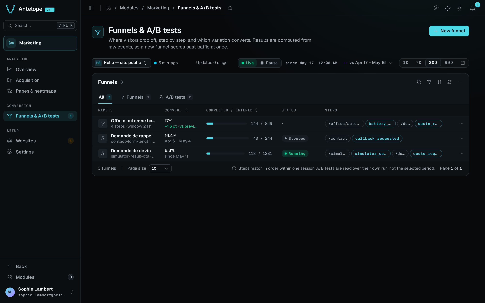
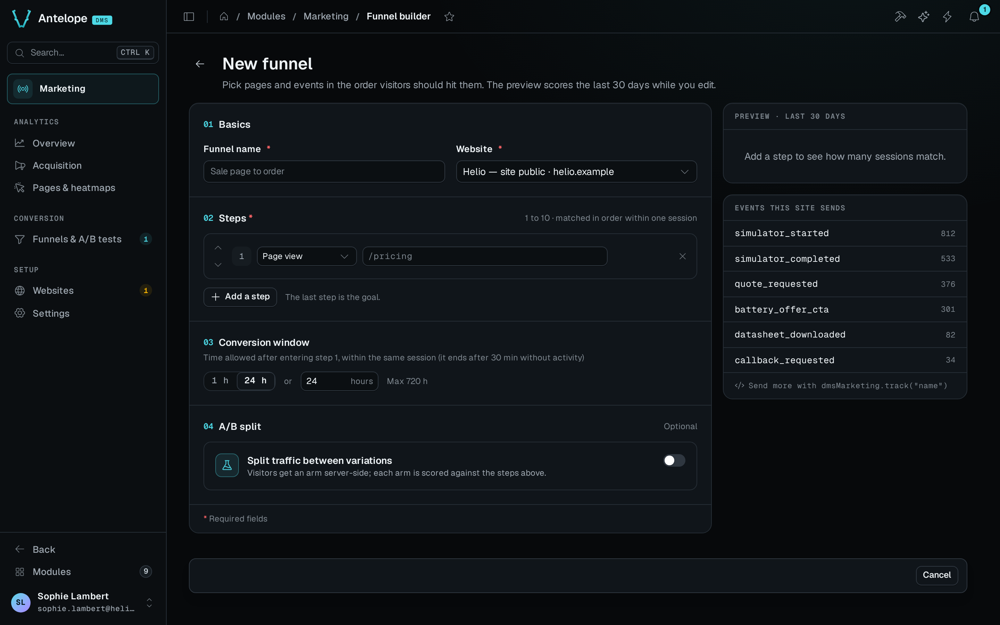
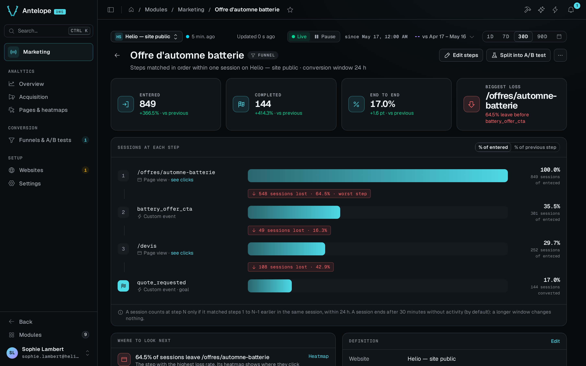

A funnel is an ordered conversion journey, such as "landed on `/pricing`, then submitted the signup form", measured over the sessions of a period. The funnels list is at `/modules/marketing/funnels`, under **Conversion** in the sidebar. Each funnel opens on its report page, `/modules/marketing/funnel?id=<funnel id>`, and the builder at `/modules/marketing/funnel-builder` creates and edits funnels.

A funnel can also be split into A/B variations. The backend then assigns every visitor an arm, the page applies it, and the report reads the funnel once per arm with a significance verdict. [A/B tests](/docs/modules/marketing/usage/ab-tests) covers splits.

## The funnels list

The list has one row per funnel of the website picked in the [context bar](/docs/modules/marketing/usage/overview#the-context-bar). Each row shows the following:

- The end-to-end conversion. For a plain funnel or a draft split, its change against the comparison window shows under it, in points, as *vs previous period* or *vs previous year*. **No comparison** shows no change. For a started split, the line under it gives the dates of the test's run instead.
- The sessions that completed out of the sessions that entered, as a bar.
- The status of the A/B split, if the funnel has one.
- The steps as pills. Event steps are outlined in the primary colour, and page steps are plain.

The line under the name gives the steps and the window. For a split, it gives the split's state instead: a draft and its number of variations, no visitor exposed yet, no leader yet, the control leading, or the leading variation by its letter with its lift. A step the site never sent over the period replaces all of these, in amber.

A click on a row opens the report. The row's menu edits, duplicates or deletes the funnel. Deleting asks you to type the funnel's name, and for a running test the dialog says that deleting stops it. The **Funnels** and **A/B tests** tabs narrow the table to one kind.

The banner above the table shows one message, the first that applies:

1. Days of the period that the raw events do not cover. Funnels count nothing for those days.
2. A running test that is ready to decide. It is significant, its leader is ahead of the control, it has served a full week, and every arm has 50 conversions.
3. A comparison window left out because the raw events do not cover it. The list leaves the change out rather than show a +1,000 % change.

The sidebar badge of the page counts the running A/B tests of the workspace.

## Templates for a website without funnels

A website without any funnel shows up to two templates instead, built from its own journeys over the period. Each template is one of the custom events triggered by the most sessions, led by the page those sessions viewed most often before it. Each template shows the number of sessions that would enter it. One click opens the builder with its steps filled in (`?steps=`). **Start from scratch** opens the builder empty.

## The funnel builder

**New funnel** in the page header opens the builder. **Edit** on a report opens the builder on that funnel (`?id=`).

The builder has these fields:

- **Steps.** From 1 to 10 steps, each either a page URL or a custom event. The last step is the goal, and a single step counts conversions on its own.
  - A **page URL** step is a path the visitor must view. A pasted URL, a query string, a fragment, or a trailing slash comes down to the path, and matching ignores case. A final `*` matches every path that starts with the rest, as in `/blog/*`.
  - A **custom event** step is a name that page code reports through `window.dmsMarketing.track(...)`. See [Tracker and custom events](/docs/modules/marketing/usage/tracking#custom-events).
  - The fields suggest the site's tracked pages and custom events of the last 30 days, with their views or triggers.
- **Conversion window.** The time a session has to complete the journey after it enters step 1. The presets are **1 h** and **24 h**, and the custom field takes any whole number of hours. The default is 24 hours and the maximum is 720 hours.
- **Website.** A funnel belongs to one website. A plain funnel or a draft split can move to another website. A started split stays on its website.
- **A/B split.** Off by default. See [Split a funnel](/docs/modules/marketing/usage/ab-tests#split-a-funnel).

A funnel matches within one session, and a session ends after 30 minutes without activity by default. A window longer than the session therefore changes nothing, and the builder does not offer 7 or 30 days. Journeys across visits would need a read per visitor. The visitor hash is salted per month, so such a read would also break at each month boundary.

Steps match in order within a session. A session counts for step N only if it already matched steps 1 to N−1, earlier in time.

### The preview

While you edit, the preview scores the definition over the last 30 days and saves nothing. It calls `POST /api/marketing/funnels/preview` and shows the sessions at each step, the share of the previous step that reached it, and the end-to-end conversion. The endpoint answers invalid steps with a `400`, never a server error.

### Duplicate a funnel

**Duplicate** in the builder's header opens a new funnel filled with a copy of the current one (`?copy=<id>`). The name becomes *Copy of …*, and the steps, the window and the arms are kept. The experiment key is left empty, because keys are unique per website and a new hypothesis is a new key.

The copy stays unsaved until you click **Save funnel**. **Cancel** in the save bar drops the copy and goes back to the funnel it was copied from. Leaving a copy you have not touched asks nothing. Only edits to the copy are guarded.

### Saving and leaving

The builder follows the DMS form contract:

- **Unsaved changes** appear only once a value differs from what the page opened on. Putting the value back clears them.
- **Discard** restores the values the page opened on.
- With unsaved changes, leaving asks first. That covers **Cancel**, the back arrow, the sidebar, the browser's **Back** button and a reload.
- **Save funnel** checks the form before it sends it and shows each problem under its field. The name holds up to 100 characters, a step up to 500 characters, and the window is a whole number of hours from 1 to 720. [A/B tests](/docs/modules/marketing/usage/ab-tests#split-a-funnel) gives the rules for keys and weights. A value the server refuses also shows under its field.

On a split that has started, changing the steps or the window shows a warning. Saving then asks for confirmation, because the report scores every arm again over the whole test with the new goal.

## The funnel report

The breadcrumb ends with the funnel's name once the report has loaded.

The report of a plain funnel opens on four figures:

- **Entered.** The sessions that matched step 1, with the change against the comparison window.
- **Completed.** The sessions that reached the goal, with the change against the comparison window.
- **End to end.** The conversion from step 1 to the goal, with the change in points.
- **Biggest loss.** The step with the highest loss rate.

Below them, one bar per step carries the sessions that reached it. A toggle reads the bars as **% of entered** or **% of previous step**. Each bar shows the sessions lost before the next step, and the step with the biggest loss carries a **worst step** flag.

**Where to look next** names the worst step, with a link to its heatmap when the step is a page. It also gives the share of sessions that never reach step 2, with a link that opens the builder to split the funnel into an A/B test. **Definition** restates the steps, the window and the website.

The report of a split that has started is the A/B test's report. See [Read the results](/docs/modules/marketing/usage/ab-tests#read-the-results).

### Results come from raw events at read time

The report computes results at read time from the raw events of the selected period. A new funnel definition therefore shows results for past traffic at once, with no wait for data to accumulate. The period cannot reach past the raw events retention, which is 90 days by default.

One computation reads at most 200,000 events (`MAX_FUNNEL_EVENTS`). Past that cap, a **Window truncated** warning says that the numbers cover only the oldest part of the period.

## Delete a funnel

**Delete funnel…** on the report page asks for the funnel's name. The definition goes, and its A/B split with it. The collected events stay. For a running test, the dialog says that deleting stops the test at once and that its results can no longer be read. Pages that ask for the deleted split's key fall back to the control within the definitions cache TTL of 30 seconds.
