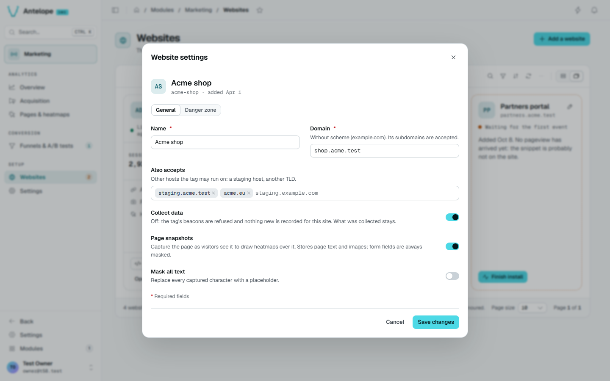
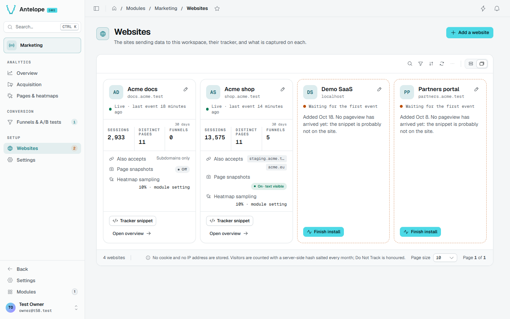

# Websites and install guide

**Where:** `/modules/marketing/websites` and the install guide `/modules/marketing/install`, under **Setup**.

Every tracked site is a *website* row, and its id is what the tracker embeds.
Add it from the console: **Add a website** in the Websites page header opens
a modal asking for a name and an apex domain; once the site is created, the
install guide (`/modules/marketing/install`) opens on it, at the tag to
embed. The first-run screen every analytics page shows while the workspace
has no website leads to the guide directly: its three steps create the
website, show the tag to embed with the id filled in, and check the
connection (see [Verify](/docs/modules/marketing/installation#verify)).


The Websites page (`/modules/marketing/websites`) lists the sites
afterwards in a DMS table view, one card each (cards about 500 px wide at
least, as many per row as fit, stretched to fill it): its state (live, imported history only, waiting for its first pageview,
paused), its sessions, distinct pages and funnels over the last 30 days, the
hosts it accepts, and its snapshot and sampling state. The table's toolbar
searches the sites by name or domain, filters them on **Tracking** and
**Page snapshots**, sorts them, counts them and reads them again (refresh,
and live when a site is added, changed or deleted elsewhere); its display
switcher also offers a plain grid. Any card names the
hosts refused for it, each with **Allow this host**; a paused site offers
**Resume tracking**; a banner says when collection is paused for the whole
module (Settings). A site still waiting leads back to its install guide; the
sidebar badge on Websites counts those sites (paused ones excluded).

A click on a card, or its pencil, opens the site's settings in a modal (the
snapshot pill opens it scrolled to that switch). The URL names the open
site, `?record=<id>`, so the modal can be linked to and reopens on reload;
`&setting=snapshots` scrolls it to the snapshot switch (the Pages &
heatmaps preview links there). An older `?edit=<id>` link lands on the same
modal. The modal holds two tabs: **General** (name, domain, extra hosts,
**Collect data** — off pauses the site: its beacons are refused, what was
collected stays — and right below it **Page snapshots** and **Mask all
text**, a change to which discards the site's snapshots, the modal saying
how many and Save asking for confirmation — even with none stored yet,
except when only turning snapshots on; declining puts the switches back) and **Danger zone**. Closing it with changes not saved asks first.

The **Danger zone** tab holds, for any site, two purges, both owner-only,
irreversible and confirmed by typing the domain, the dialog counting what
goes over every stored day:

- **Purge heatmaps…** deletes the clicks, scroll depths and page snapshots
  of every page: click counts drop to zero everywhere (pages list, preview,
  most clicked). Pageviews, sessions, funnels and A/B tests are kept.
- **Purge all data…** deletes everything collected: raw events (pageviews,
  clicks and scroll depths, A/B exposures and goals), sessions, daily
  statistics, page snapshots and imported history.

Either way the website stays, with its settings, funnels and A/B tests,
whose results start again from zero. The toast gives what was deleted and
the cards read again. Below them, **Delete website…** lists what goes —
sessions, pageviews, funnels with their A/B tests, snapshots — and asks for
the domain; it is not offered for the dashboard's own website (below).





The REST API creates the same row with a DMS JWT (tenant owner):

```bash
curl -X POST https://<backend>/api/marketing/websites \
  -H "Authorization: Bearer <jwt>" \
  -H "Content-Type: application/json" \
  -d '{"name": "Main site", "domain": "example.com"}'
```

- `name` — display name in the dashboards.
- `domain` — the site's apex domain, scheme-less. Classifies referrers (an
  internal navigation is never counted as an acquisition source) **and
  gates ingestion**: a beacon is refused unless the browser-reported Origin
  hostname is this domain, a subdomain of it, or one of `extraDomains`.
  Never used to build URLs.
- `extraDomains` — optional; other hosts the site legitimately serves from
  (another TLD, a staging host, localhost), same apex-or-subdomain rule.

Both are stored as bare lowercase hostnames: a scheme, a port, a path or
spaces are stripped (`https://Shop.Example.com/x` → `shop.example.com`), and
anything that is not a hostname, an IP or `localhost` is refused with a 400
whose zod issues name the field. A host another website of the workspace
already declares (domain or extra host) is refused with a 409
`{ field, message, values }`. `PUT /api/marketing/websites/:id` takes the
same keys plus `trackingEnabled` (false pauses the site).
- `snapshotsEnabled` — optional, off by default; lets the tracker capture a
  masked rendering of each tracked page as the heatmap's backdrop. This
  stores page content, unlike anything else in the module — read
  [Pages & heatmaps](/docs/modules/marketing/usage/pages-and-heatmaps#page-snapshots) before enabling it.
  Also switchable from the **General** tab of the website's settings (under
  **Collect data**) and, as a shortcut, from the preview's **More** menu on
  Pages & heatmaps. `snapshotMaskText` masks
  every text node of the captures on top of the always-masked form values.

The response carries the website's `_id` — the value for `data-website-id`
below, the one the install guide already fills in.

**The dashboard's own website.** With
[`dashboardTracking`](/docs/modules/marketing/configuration#tracking-the-dashboard-itself)
on, the module creates one more website per workspace, for the dashboard's
pages, the first time someone signed in opens it. It is an ordinary card
but for one thing: it cannot be deleted (the Danger zone says so, and
`DELETE /api/marketing/websites/:id` answers 409). Rename it, pause its
tracking, turn its snapshots off or purge its data instead. It is left out of the duplicate-host check both ways —
it shares its host with whatever else runs there (a site in development on
`localhost`) without splitting anyone's traffic, since its tag is the
module's. Its page snapshots are off unless `dashboardTracking.snapshots`
turns them on (text masked): a capture stores the records the admin pages
show. Whoever changes the switch on its card takes it over from the
configuration for good.
