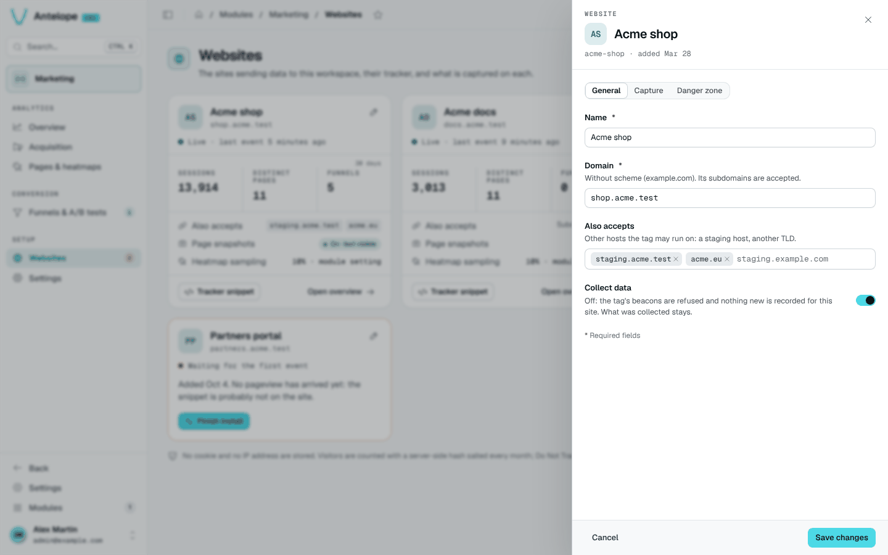

# Websites and install guide

**Where:** `/modules/marketing/websites` and the install guide `/modules/marketing/install`, under **Setup**.

Every tracked site is a *website* row, and its id is what the tracker embeds.
Add it from the console: **Add a website** on the Websites page — or on the
first-run screen every analytics page shows while the workspace has no
website — opens the install guide (`/modules/marketing/install`). Its three
steps create the website from a name and an apex domain, show the tag to
embed with the id filled in, and check the connection (see
[Verify](/docs/modules/marketing/installation#verify)).


The Websites page (`/modules/marketing/websites`) lists the sites
afterwards, one card each: its state (live, imported history only, waiting for its first pageview,
paused), its sessions, distinct pages and funnels over the last 30 days, the
hosts it accepts, and its snapshot and sampling state (the snapshot pill
opens the site's settings on that switch; `?edit=<id>&setting=snapshots`
links there too). Any card names the
hosts refused for it, each with **Allow this host**; a paused site offers
**Resume tracking**; a banner says when collection is paused for the whole
module (Settings). A site still waiting leads back to its install guide; the
sidebar badge on Websites counts those sites (paused ones excluded). A
site's drawer holds two tabs: **General** (name, domain, extra hosts,
**Collect data** — off pauses the site: its beacons are refused, what was
collected stays — and right below it **Page snapshots** and **Mask all
text**, a change to which discards the site's snapshots, the drawer saying
how many) and **Danger zone** (delete the website: it lists what goes, over every stored day —
sessions, pageviews, funnels with their A/B tests, snapshots — and asks for
the domain).




The REST API creates the same row with a DMS JWT (tenant owner):

```bash
curl -X POST https://<backend>/api/marketing/websites \
  -H "Authorization: Bearer <jwt>" \
  -H "Content-Type: application/json" \
  -d '{"name": "Main site", "domain": "example.com"}'
```

- `name` — display name in the dashboards.
- `domain` — the site's apex domain, scheme-less. Classifies referrers (an
  internal navigation is never counted as an acquisition source) **and
  gates ingestion**: a beacon is refused unless the browser-reported Origin
  hostname is this domain, a subdomain of it, or one of `extraDomains`.
  Never used to build URLs.
- `extraDomains` — optional; other hosts the site legitimately serves from
  (another TLD, a staging host, localhost), same apex-or-subdomain rule.

Both are stored as bare lowercase hostnames: a scheme, a port, a path or
spaces are stripped (`https://Shop.Example.com/x` → `shop.example.com`), and
anything that is not a hostname, an IP or `localhost` is refused with a 400
whose zod issues name the field. A host another website of the workspace
already declares (domain or extra host) is refused with a 409
`{ field, message, values }`. `PUT /api/marketing/websites/:id` takes the
same keys plus `trackingEnabled` (false pauses the site).
- `snapshotsEnabled` — optional, off by default; lets the tracker capture a
  masked rendering of each tracked page as the heatmap's backdrop. This
  stores page content, unlike anything else in the module — read
  [Pages & heatmaps](/docs/modules/marketing/usage/pages-and-heatmaps#page-snapshots) before enabling it.
  Also switchable from the **General** tab of the website's drawer (under
  **Collect data**) and, as a shortcut, from the preview's **More** menu on
  Pages & heatmaps. `snapshotMaskText` masks
  every text node of the captures on top of the always-masked form values.

The response carries the website's `_id` — the value for `data-website-id`
below, the one the install guide already fills in.

**The dashboard's own website.** With
[`dashboardTracking`](/docs/modules/marketing/configuration#tracking-the-dashboard-itself)
on, the module creates one more website per workspace, for the dashboard's
pages, the first time someone signed in opens it. It is an ordinary card:
rename, pause or delete it (it comes back on the next dashboard visit while
the option is on). It is left out of the duplicate-host check both ways —
it shares its host with whatever else runs there (a site in development on
`localhost`) without splitting anyone's traffic, since its tag is the
module's. Its page snapshots are off unless `dashboardTracking.snapshots`
turns them on (text masked): a capture stores the records the admin pages
show. Whoever changes the switch on its card takes it over from the
configuration for good.
