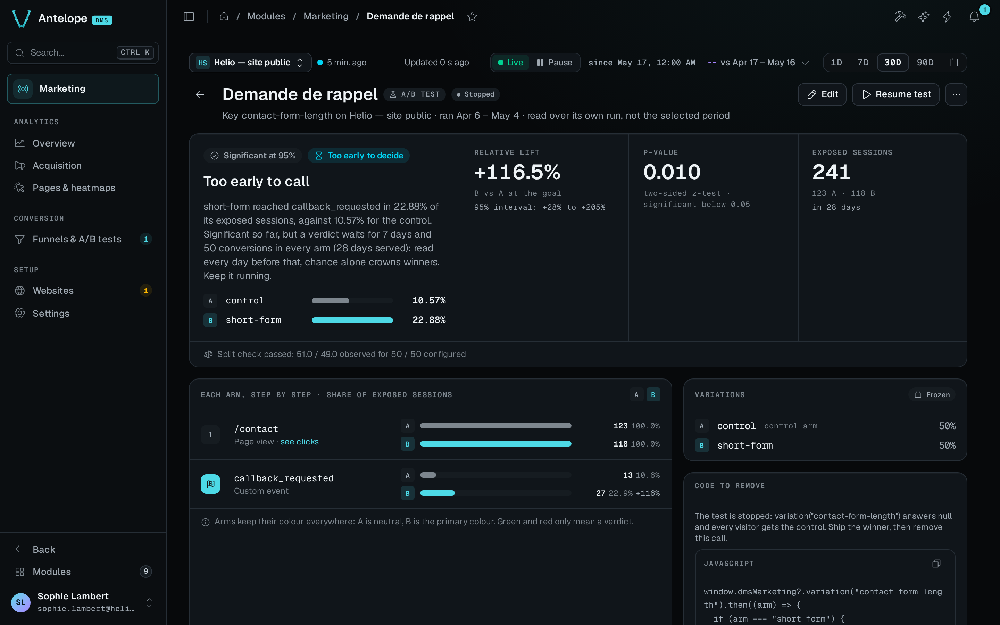

An A/B test is a funnel split into variations. The backend assigns every visitor an arm, the page applies it, and the funnel's report reads the funnel once per arm with a significance verdict. The funnel's own steps are the goal that every arm is scored against, so nothing else needs to exist. [Funnels](/docs/modules/marketing/usage/funnels) covers the funnel itself.

## Split a funnel

Turn on **Split traffic between variations** in the builder. **Split into A/B test** on a report opens the builder with the switch already on (`?split=1`). A split has these fields:

- **Experiment key.** The slug that page code asks for. It uses lowercase letters, digits, `-` and `_`, starts with a letter or a digit, and holds up to 64 characters. Keys are unique per website.
- **Variations.** From 2 to 8 variations, each a key and a weight. Variation keys follow the same rule as the experiment key. The first variation is the control.
- **Weights.** Weights are relative, and the backend normalizes them. Each weight is 0 or more, and at least one is above 0. The builder shows each weight as its share of the traffic.

The builder also shows the `variation()` snippet for the key, and a sample-size hint. The hint gives how many entered sessions it takes to detect a +20% relative lift at the preview's conversion rate, with a two-proportion test at 95% confidence and 80% power. It sizes the sample on the arm with the smallest share of the traffic, so uneven weights take longer. It also gives how many months that is at the site's current traffic. The hint is hidden once the split has started.

The assignment flows from the funnel definitions to the report:

```text
marketing_funnels, split running
        |
        v
GET /api/marketing/experiments.js?website=<id>   (public, per visitor, no-store)
        |
        v
await dmsMarketing.variation("hero-cta")        (the page applies the arm)
        |
        v
exposure events through collect
        |
        v
A/B report: each arm step by step, with a z-test
```

## The test lifecycle

A split moves from `draft` to `running`, and between `running` and `stopped`. Nothing returns to `draft`. The **Start test**, **Stop test** and **Resume test** buttons of the report page drive it, each behind a confirmation:

- **Start test** lists what freezes, which is the key and the variations with their shares. It reminds you that the page must call `variation()`.
- **Stop test** says that every visitor gets the control again.
- **Resume test** says that visitors get their variations again, bucketed as before.

Only `running` splits are served to visitors. The key and the variations freeze once the split leaves draft, because moving weights during a run would shift the deterministic buckets and reassign visitors without notice. The name, the steps and the window stay editable at any status. Results are computed at read time, so a step change scores past traffic again at once and never touches assignment.

You can remove the split itself only while it is a draft. A stopped split keeps its results readable until the funnel is deleted. You can delete the funnel at any status, and pages then fall back to the control within the definitions cache TTL of 30 seconds.

While the split is a draft, the report reads as the plain funnel under a *Saved as a draft* notice. That plain funnel is the baseline the arms will be compared to.

### Stopping ends the measurement

From the stop on, `experiments.js` serves no assignment for the key. Every visitor falls back to the control within the definitions cache TTL of 30 seconds, and pages that are already open fall back at their next reload. Collect refuses exposures for the key, and the report reads the results over the runs that closed, so the numbers of a stopped split are final. Sessions exposed shortly before the stop keep the funnel's whole conversion window to reach the goal, and those late conversions still count.

A draft has no results at all, only the plain funnel underneath it.

### Resuming continues the same test

The arms and their weights are frozen, so a visitor lands on the same arm as before. The sessions already exposed stay in the counts. The split gains a second run, and the pause between the two runs counts for nothing, with no assignment and no exposure.

Resume a test when the stop was accidental or too early. Do not resume a test because the verdict was not the one you hoped for. Stopping on a p-value and gathering more data until it moves is optional stopping, and it raises the false-positive rate well past the 5% the verdict claims. To test a changed hypothesis, with other arms or other weights, create a new split.

## Serve the variation on the site

The page calls `variation()` where it applies the variation:

```js
window.dmsMarketing?.variation("hero-cta").then((arm) => {
  if (arm === "b") {
    showAlternateHero();
  }
});
```

The call returns a promise, so it runs as it is in a classic `<script>`. A top-level `await` works only in a module script. The builder's snippet has the same shape.

- **The server assigns the arm, and the same visitor gets the same arm.** The bucket is `sha256(visitorId:key)` placed against the normalized weights. The same visitor keeps the same arm for the whole month, because the identity salt changes each month. See [Architecture](/docs/modules/marketing/architecture#anonymous-identity). Nothing is stored on the visitor's device.
- **`null` means render the control.** The answer is `null` when the key is unknown or not running, when the website's tracking or the module's collection is paused, and when the browser sends Do Not Track or Global Privacy Control. Treat every answer that matches no challenger as the control, and the page keeps working.
- **The call reports the exposure itself**, once per page load, and only for the keys the page asked for. A split that the page fetched but never asked for counts nobody as exposed.
- **Call it in the browser only.** The assignment derives from the visitor's own request, its IP address and user agent. A fetch at server-side rendering time would put every visitor behind the renderer's single identity, with one arm for everyone. To assign on the server, run your own split and report it with `dmsMarketing.exposure(experiment, variation)`. The backend accepts that exposure only while the split is running, like the assignment it replaces.

## Read the results

Once the split has started, the funnel's report is the A/B test's report. It scores the arms against the funnel's own steps, so there is nothing else to pick. The computation runs at read time over the raw events, so editing the steps scores past traffic again at once.



### The report reads the split's own runs

The report reads the split's own runs, not the period of the context bar. The line under the title says which runs, as in *running since 12 Aug (20 days)*, or *ran* followed by the first and last dates. An A/B reading is the whole sample gathered since the start. Cutting it to the last 7 days would answer a different question, and a stopped split would keep changing as the period moves past it. The period still drives every other page, and the plain funnel of a split that is still a draft.

### The verdict

The report opens on the verdict, as a sentence with its next action, such as *Variation B converts 12% better than the control … Stop the test, then ship b on the site*. Beside it, the report shows these figures:

- **Relative lift.** The lift of the best-converting challenger at the goal, with its 95% interval, as in *+23% to +101%*.
- **p-value.** The result of a two-sided z-test, significant below 0.05.
- **Exposed sessions.** The sessions exposed to the test, with the days served.

With more than one challenger, the verdict judges only the best arm. Each challenger is tested at 0.05 divided by the number of challengers (Bonferroni), so with three arms a result is significant at 97.5%. Every arm keeps its own figures below the verdict.

A significant reading reads **Ready to decide** only once the split has served a full week and every arm has 50 conversions. Before that, it reads *Too early to call*, because a p-value checked every day crosses 0.05 by chance long before the test has its sample. The banner of the funnels list follows the same rule.

A stopped test tells you to ship the winner on the site, then remove the `variation()` call. A running test that nobody was exposed to says to check the call, instead of showing 0% rates.

### Each arm, step by step

Each arm then shows every step, so the arms compare at every step of the way and not only at the goal. Every figure is a share of that arm's exposed sessions, not of the funnel's entries, because entering the funnel is itself an outcome the variation influences. Each arm keeps one colour everywhere. A is neutral, B is the primary colour, and further arms take other tones. Green and red only ever mean a verdict. The report closes on the frozen variations with their weights, and on the snippet the page calls.

### When the verdict is withheld

The report withholds the verdict, and never guesses one, when the sample is too thin, when the split check failed, or when the event window was truncated. When no challenger reaches a verdict on a healthy window, the report also withholds the rates. A *Too few conversions to compare the arms* card gives the raw counts per arm instead, exposed sessions and sessions that reached the goal, until at least one challenger has a verdict. A challenger gets one once both it and the control have at least 5 sessions that reached the goal and 5 that did not.

Two warnings can appear above the numbers:

- **Sample ratio mismatch.** The observed split across the arms is too far from the configured weights, by a chi-square test at p < 0.001. Assignment or exposure reporting is broken somewhere, so do not trust the numbers.
- **Window truncated.** The raw-event read hit its cap of 200,000 events (`MAX_FUNNEL_EVENTS`). The numbers cover only the oldest part of the run, and the verdict is withheld.

A passing split check shows as one line, *Split check passed*.

## Limits of a reading

- **The unit is the session.** A visitor exposed in one session who converts in the next without a new exposure does not count. Sessions exposed to two arms of the same split, for example when the identity salt changes during the session, are left out of every arm.
- **Results live as long as raw events.** Exposures and conversions share the raw-event retention. Past it, both sides of the ratio fade together, including the final reading of a stopped split. The module has no export of a reading, so copy the final figures of a finished test you want to keep before the retention reaches its start.
- **One month is the natural horizon.** On the 1st of the month the identity salt changes and visitors draw their arm again. The per-session unit keeps the statistics valid, but a split that runs for months mixes populations.
- **Several challengers use a correction.** Each challenger is tested at `0.05 / number of challengers` (Bonferroni). With one control and two challengers, each comparison uses 0.025. The correction does not cover checking the result again and again and stopping as soon as it becomes significant.
