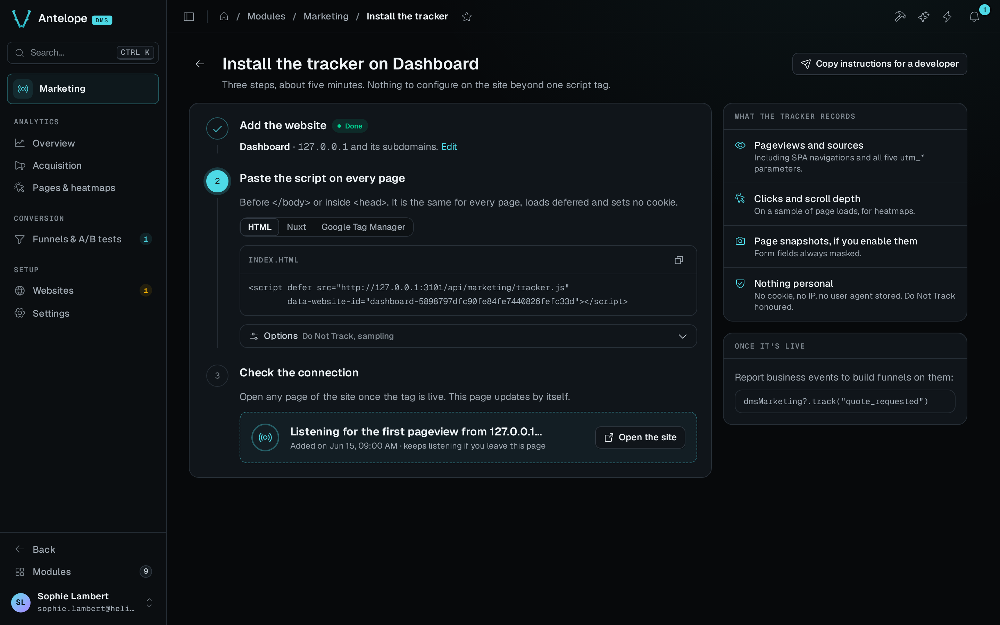
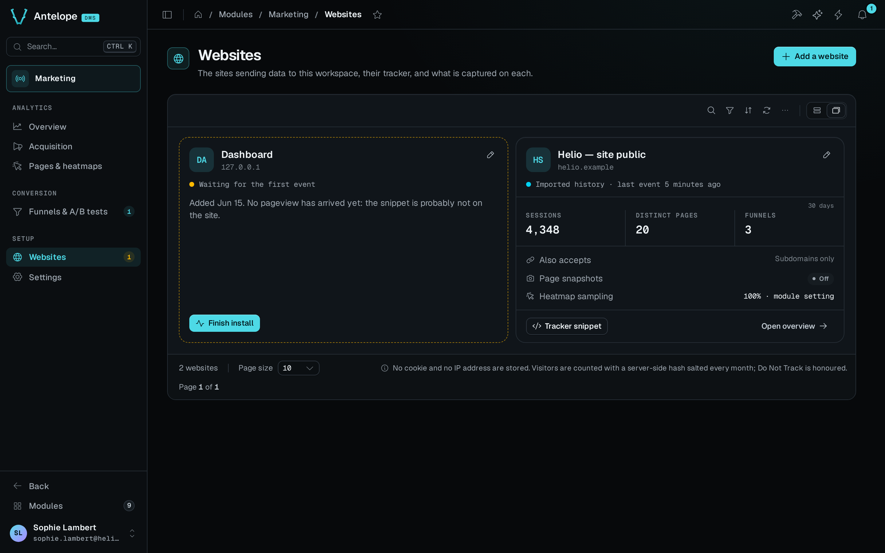
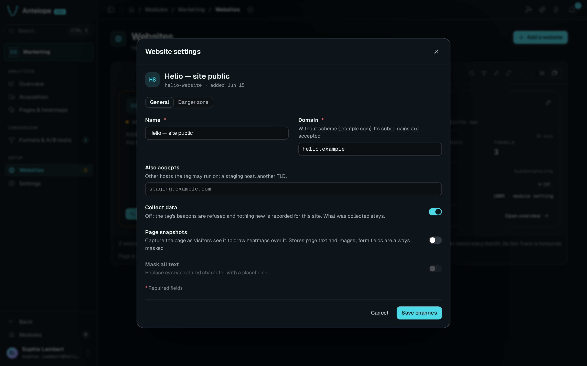

Every tracked site is a website row, and the tracker embeds its id. The Websites page is at `/modules/marketing/websites` and the install guide at `/modules/marketing/install`, both under **Setup** in the sidebar.

## Add a website

**Add a website** in the header of the Websites page opens a modal that asks for a name and an apex domain. Once the site exists, the install guide opens on it, at the tag to embed.

While the workspace has no website, every analytics page shows a first-run screen that leads to the install guide. The guide has three steps. It creates the website, shows the tag to embed with the website id filled in, and checks the connection. See [Verify](/docs/modules/marketing/installation#verify).



## Website cards

The Websites page lists the sites in a DMS table view, one card per site. Each card is at least about 500 px wide, and a row holds as many cards as fit, stretched to fill it. A card shows the following:

- The site's state. A site is live while its last event is under 5 minutes old, and otherwise shows the time of that event. The other states are imported history only, waiting for its first pageview, and paused.
- Its sessions, distinct pages and funnels over the last 30 days.
- The hosts it accepts.
- Its page snapshot state and its heatmap sampling.



The toolbar of the table searches the sites by name or domain, filters them on **Tracking** and **Page snapshots**, sorts them, and counts them. It reads the sites again on refresh, and live when someone adds, changes or deletes a site elsewhere. Its display switcher also offers a table instead of the cards.

- A card names the hosts that were refused for its site, each with **Allow this host**.
- A paused site offers **Resume tracking**.
- A site still waiting for its first pageview leads back to its install guide. The sidebar badge of the Websites page counts those sites, paused sites excluded.
- A banner says when collection is paused for the whole module, from [Settings](/docs/modules/marketing/usage/settings#collection).

## The website settings modal

A click on a card, or on its pencil, opens the site's settings in a modal. The snapshot pill on a card opens the modal scrolled to the snapshot switch. The URL names the open site as `?record=<id>`, so you can link to the modal and it opens again on reload. Adding `&setting=snapshots` scrolls it to the snapshot switch. The preview of Pages & heatmaps links there, and the **Edit** link of the install guide links to the modal itself.

Closing the modal with unsaved changes asks first. The modal has two tabs, **General** and **Danger zone**.



### General

The **General** tab holds the name, the domain and the extra hosts, then these switches:

- **Collect data.** Off pauses the site. The backend refuses its beacons, and what was collected stays.
- **Page snapshots** and **Mask all text**, right below **Collect data**. A change to either one discards the site's snapshots. The modal says how many snapshots go, and **Save** asks for confirmation, even when none is stored yet. Turning snapshots on, with no other snapshot change, asks nothing. Declining the confirmation puts the switches back.

### Danger zone

The **Danger zone** tab holds two purges for any site. Both are for the workspace owner only and cannot be undone. Each asks you to type the domain, and its dialog counts what goes over every stored day.

- **Purge heatmaps…** deletes the clicks, the scroll depths and the page snapshots of every page. Click counts drop to zero everywhere: the pages list, the preview and the most clicked elements. Pageviews, sessions, funnels and A/B tests are kept.
- **Purge all data…** deletes everything collected. That is the raw events (pageviews, clicks, scroll depths, A/B exposures and goals), the sessions, the daily statistics, the page snapshots and the imported history.

Either way, the website stays with its settings, its funnels and its A/B tests, whose results start again from zero. The toast gives what was deleted, and the cards read again.

Below the purges, **Delete website…** lists what goes: the sessions, the pageviews, the funnels with their A/B tests, and the snapshots. It asks for the domain. It is not offered for the dashboard's own website.

## Register a website through the API

The REST API creates the same row as the modal. The call needs a DMS JWT of the tenant owner:

```bash
curl -X POST https://<backend>/api/marketing/websites \
  -H "Authorization: Bearer <jwt>" \
  -H "Content-Type: application/json" \
  -d '{"name": "Main site", "domain": "example.com"}'
```

The body takes these keys:

- `name`. The display name in the dashboards, up to 100 characters.
- `domain`. The site's apex domain, without a scheme. It classifies referrers, so an internal navigation never counts as an acquisition source. It also gates ingestion. The backend refuses a beacon unless the hostname of the browser-reported `Origin` is this domain, a subdomain of it, or one of `extraDomains`. The module never builds a URL from it.
- `extraDomains`. Optional. Up to 20 other hosts the site serves from, such as another TLD, a staging host, or `localhost`, under the same domain-or-subdomain rule.
- `snapshotsEnabled`. Optional and off by default. It lets the tracker capture a masked rendering of each tracked page as the heatmap's backdrop. This stores page content, unlike anything else in the module, so read [Page snapshots](/docs/modules/marketing/usage/pages-and-heatmaps#page-snapshots) before you turn it on. The **General** tab of the website's settings also switches it, and so does the **More** menu of the preview on Pages & heatmaps.
- `snapshotMaskText`. Optional and off by default. It masks every text node of the captures, on top of the form values that are always masked.

The backend stores `domain` and `extraDomains` as bare lowercase hostnames. It strips a scheme, a port, a path and spaces, so `https://Shop.Example.com/x` becomes `shop.example.com`. A value that is not a hostname, an IP address or `localhost` gets a `400` whose zod issues name the field. A host that another website of the workspace already declares, as its domain or as an extra host, gets a `409` with `{ field, message, values }`.

`PUT /api/marketing/websites/:id` takes the same keys plus `trackingEnabled`, where `false` pauses the site. It changes only the keys present in the body.

The response carries the website's `_id`. That is the value of the tag's `data-website-id`, which the install guide already fills in.

## The dashboard's own website

With [`dashboardTracking`](/docs/modules/marketing/configuration#tracking-the-dashboard-itself) on, the module creates one more website per workspace, for the dashboard's own pages, the first time a signed-in user opens the dashboard. It is an ordinary card, except that it cannot be deleted. The Danger zone says so, and `DELETE /api/marketing/websites/:id` answers `409`. You can rename it, pause its tracking, turn its snapshots off, or purge its data instead.

The duplicate-host check leaves this website out in both directions. It shares its host with whatever else runs there, such as a site in development on `localhost`, without splitting anyone's traffic, because its tag is the module's.

Its page snapshots are off unless `dashboardTracking.snapshots` turns them on, with text masked, because a capture stores the records that the admin pages show. Whoever changes the snapshot switch on its card takes it over from the configuration for good. A platform owner can also read the heatmaps of every workspace's dashboard website from their own. See [Reading another workspace's dashboard](/docs/modules/marketing/usage/pages-and-heatmaps#reading-another-workspaces-dashboard).
