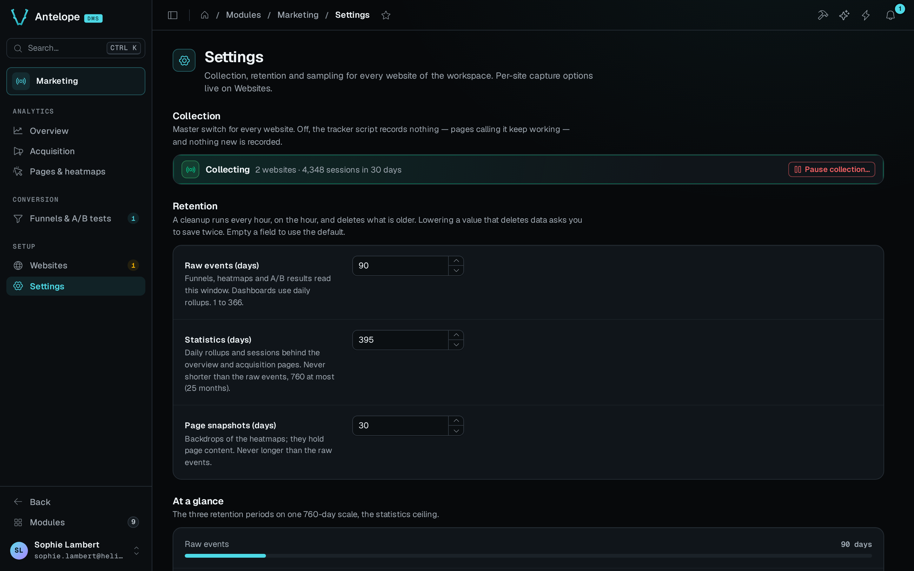

The Settings page is at `/modules/marketing/settings`, under **Setup** in the sidebar. Its endpoints answer platform owners only. Values apply without a restart. Clearing a numeric field, or clicking **Use default** under it, puts the deployment's configuration default back in force, and the empty field shows that default as its placeholder.

The settings row is global to the deployment. It drives collection and retention for every tenant and every website. The capture options of one site, page snapshots and text masking, live in that website's settings on the [Websites](/docs/modules/marketing/usage/websites#the-website-settings-modal) page.

## Collection

The Collection section holds the master switch, outside any form. It states whether the module is collecting, with the workspace's websites and their sessions over the last 30 days. **Pause collection…** asks for confirmation and lists what pausing does:

- The tracker script becomes a stub on every site. `window.dmsMarketing` still exists and records nothing, and `variation()` answers `null`. The collect endpoint drops every event. Client sites stop sending at the source, and page code keeps working.
- Running A/B tests stop assigning variations, so every visitor gets the control.
- Browsers that hold the cached script stop within an hour. See [Propagation delay](#propagation-delay).

Pausing deletes nothing that was collected. **Resume collection** turns collection back on. While collection is paused, the module's tile in the DMS catalog shows an attention status and reads *Collection is paused*.

## Retention

The Retention section has three fields:

- **Raw events (days).** How long the module keeps raw events (`marketing_events`). The default is 90 days, from 1 to 366. Raw events back the heatmaps, the funnels and the A/B results. The dashboards do not read them.
- **Statistics (days).** How long the module keeps the daily rollups and the sessions. The default is 395 days (13 months), from 1 to 760 days (25 months). 760 days covers two full year-over-year windows and is the ceiling most privacy regimes put on audience-measurement data. The value is never shorter than the raw-event retention, because funnels and A/B results tie raw events to their session. A lower value is refused.
- **Page snapshots (days).** How long the module keeps a captured page rendering as a heatmap backdrop. See [Page snapshots](/docs/modules/marketing/usage/pages-and-heatmaps#page-snapshots). The default is 30 days, and the value is never longer than the raw-event retention. A higher value is refused, not saved, because snapshots hold page content and a backdrop that outlives every click it could back keeps content for nothing.

An hourly job, on the hour, deletes what every store holds past its retention. **At a glance** draws the three retention periods as meters on one 760-day scale, and follows a save at once.

A value out of its bounds, such as 0 or 400 for raw events, is refused under its field. It is never clamped to the nearest bound.

Lowering a retention so that it would delete data asks for confirmation. The first save is refused under the field, with how much the next cleanup deletes: raw events, sessions, page snapshots, or daily rollups when no session is that old. Saving the same value again within ten minutes applies it. A lower value that deletes nothing saves at once.

## Sampling

**Heatmap sampling (%)** is the share of page loads that record clicks and scrolls, and page snapshots on sites that turned them on. The default is 10 %, from 0 to 100. A site's `data-heatmap-sample` attribute on its tag overrides it for that site. At 0, no heatmap records anything on the sites without that attribute.

## Saving

Each form sends only the fields you changed. The settings route, `PUT /api/marketing/settings`, merges a partial body into the stored values, so a field left out keeps its value. A default therefore never gets frozen as an override, and a tab left open does not write back what someone else saved since. A field sent as `null`, or as the configuration default itself, goes back to following the configuration default. Days and percents are whole numbers, and the route rounds a decimal.

Refusals come back as validation issues that name their field, and the form shows each one under its field:

- `400` for a value out of bounds, a snapshot retention above the raw-event retention, or a statistics retention below it.
- `409` for the first save of a retention cut that deletes data. See [Retention](#retention).
- `400` for a body that is not JSON or that carries a key the form does not know.

Every backend instance shares the settings row. Each instance reads it again every 30 seconds, before each hourly cleanup, and on each read of the Settings page. A save, the master switch included, therefore reaches every instance within 30 seconds, without a restart.

## Propagation delay

The served tracker embeds these settings, and the script response carries a one-hour cache lifetime. A sampling or switch change therefore reaches returning visitors within that hour, not at once. The stub served while collection is paused is cached for one minute only, so resuming reaches visitors within a minute.
